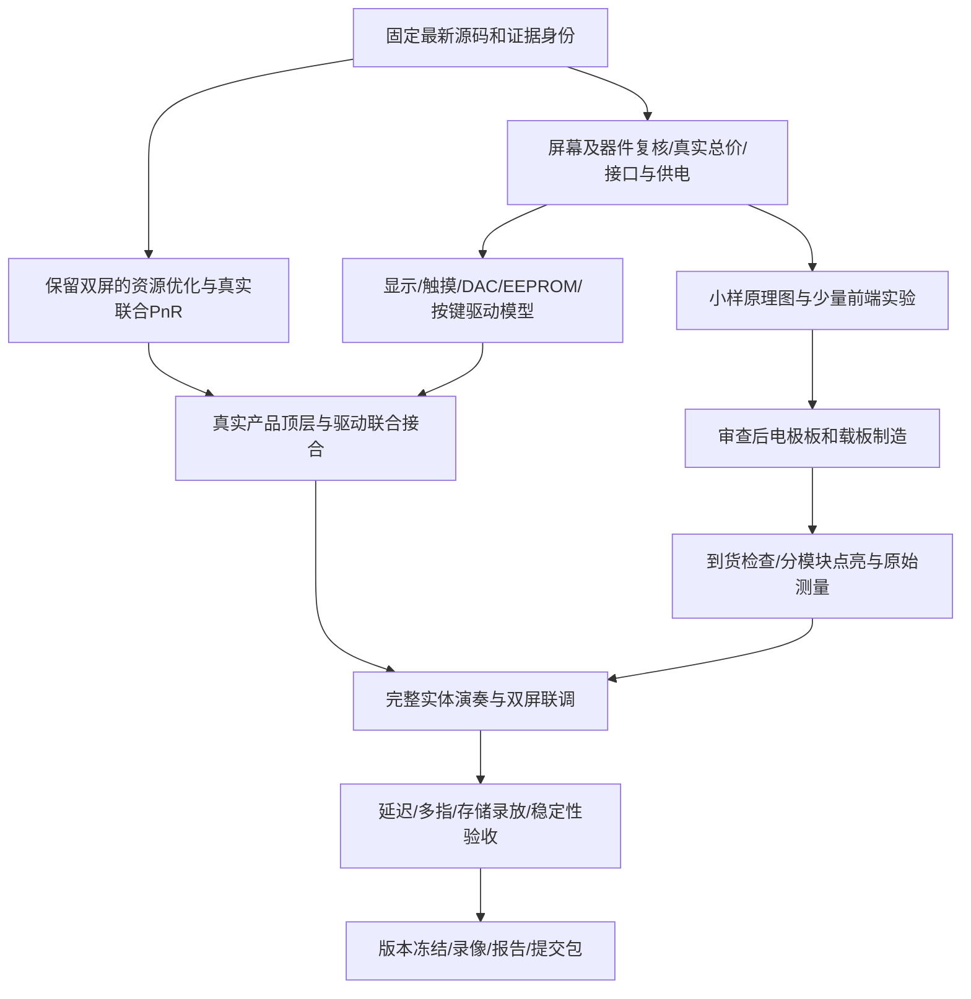

# 双屏整机完整推进计划 · 2026-10-19

> 10月20日更新：当前 v2 为 14 页、230 件、1054 焊盘的原生工程；原理图/PCB 关联和网络核对已验证。已实现部分布线、21 测试点与双面接地铜皮；完整布线、安装孔避铜、DFM 和制造放行仍在推进。按 [20日执行计划](../../hardware/review-manufacturing-20261019/执行计划-20261020.md) 与 [v2 当前状态](../../hardware/review-manufacturing-20261019/README-v2.md) 跟踪；下方 12 页记录保留历史。

> 10月19日晚追加：按用户“21日到来前完成图审、采购制造准备”的目标，已形成12页嘉立创EDA原理图候选与实际网表/BOM审查。最新结果和暂缓项见 [双屏图审与制造准备](../../hardware/review-manufacturing-20261019/README.md)。本文件后续远期计划不能代替该审查的当前放行状态。

本计划承接已找到的10月15—19日设计、86号联合实验、WorkBuddy87/88号及本聊天外围复核。用户已确认继续双屏；推子与完整可视化始终同时可见。日期按北京时间，均为推进目标，不是尚无交期/实现证据的完成承诺。

## 1. 要交付的整机

唯一实体应用计算平台为已有Tang Nano20K。保留两排逐音滑条、独立八度条、7英寸右手触屏泛音推子及独立可视化屏；保留当前32组×16分量架构及既定音乐行为。电脑连接模式依既有授权处理配置/观察，实体演奏不依赖电脑合成声音。

完整范围包括：多指音高/表情、持续/击发/混合发声、四槽乐器定义与分层、预设/编辑/按压旋钮、喇叭及AUX、参数断电保存、录制本机演奏/保存伴奏/回放时现场演奏另一内容、演奏事件及曲谱指引、波形/频谱/轨迹三视图和提交材料。

已经确认的目标不因排期自动取消。四层实现、伴奏循环/叠录/时长、指引编辑/外谱等具体未决项，按原记录保留未决，不把所有可扩展项都擅自加入首版。需要改变功能时明确列代价，由用户裁定。

在手器材以10月17日更正为准：确认Nano20K和喇叭；屏幕/前端/存储卡不当作已到货。已有5V3A电源的历史记录仍需核型号与供电路径。当前652.76元只是修正后的旧范围成本模型，不代表双屏整机最终报价。

## 2. 现有成果如何接着用

- 音乐与输入：从86号冻结engine及此前69—78号可追溯成果继续，保留事件队列、实例身份、逐指音高、配置传输、包络等已经验证部分。不在本聊天旧HEAD的根src重新开发一遍。
- 可视化：保留54/55号三视图源码与已知性能缺口；5ms短音轨迹漏记、较重刷新等问题须列验收，不把旧图像测试当实屏流畅完成。
- 存储：继承81/83号独立SDRAM与调度实测、84—86号资源优化及其边界；它们尚不能代替TF文件、最终回放混音或整机PnR。
- 硬件：继承4滑条嘉立创原生小样与88号候选，采用本聊天新核的I²S排针、读回选择器和PCM5122时钟字段；不从候选表直接下单制造。
- 版本：38—86号文档已入库，不再照旧待办重复“提交51份文档”；未跟踪实验、hardware、D盘构建证据仍需有源清单和独立保存。WorkBuddy复制目录的空evidence不能当完整备份。

## 3. 总体依赖与并行推进

完整联合设计路由失败不妨碍独立的小电极、屏幕或DAC实验，也不妨碍做原理图和驱动模型。完整整机板测必须等待对应真实源码/约束/码流通过；每个隔离实验的结论不得外推成整机完成。

## 4. 七个工作包及交付门槛

### P0：明确唯一继续开发的输入

固定86号engine/RTL/约束和此前GUI/协议的来源指纹，完整保留D盘原始构建与失败日志。后续代码在隔离目录向前接合，生成新的完整源清单，不覆盖旧delivery或用最新文件时间猜版本。保留76号已验音乐镜像与恢复入口。

交付：一份整机需求—模块—源身份—验证状态表；明确本版产品顶层、已启用文件和真实配置。根目录旧src、结构探针、独立诊断与产品版本分开标记。

### P1：保留双屏解决资源与物理实现

先以86号同配置复现资源/失败位置，再逐项检查声部分配/所有权状态、多指状态及显示绘制的数据访问、多路选择和高扇出。优先用已有RAM与音频时隙减少重复逻辑；测试包装开销独立核算，不把删除测试包装等同于必然布通，也不直接删除小屏渲染器。

逐个改动做原行为对照和有针对性的事件、释放、复位、音高、音频判据。检查可接受的处理周期，不能为省资源静默丢输入、改变音频节拍或扩大全链延迟。必要时复用真实75/76配置协议及演奏/状态读回资产，替代不能演奏的串行结构探针；其实际开销仍要纳入联合版本。

交付：每项优化的前后资源与行为对照、真实联合PnR日志及当前完整源身份。通过条件包括实际工具成功结束、约束完整、setup/hold及有关恢复/移除路径合格、生成并绑定本版码流。不能用“占用小于100%”“0 unrouted”“旧诊断时序”代验收。

先以留出合理增量空间为工程目标，但不设“低于某百分比就保证可布线”的假门槛。未加入新驱动/TF/混音/实体UI前，一次通过仍不是最终资源签收。

### P2：收口双屏BOM、供电和原生图纸

优先核ER-TFTM070-5V4的4线SPI/FT5316确切配置、真实触点能力、初始化/忙状态、连接器及含触摸完整价格；保留可追溯替代，不宣称关键词未搜到即整个平台无货。小屏以无触摸ILI9341模块候选，核字号/视角/引脚/初始化和实际报价。

复核六路4067/RC/LVC14、实际品牌ESD、输入漏电与切换寄生；先取得真实滑条信号再冻电极几何。核PCM5122供电/去耦/电荷泵/输出RC、3.5mm插座、已有喇叭及单一5V输入的分配；不并接未隔离的电源输出。

把17面板GPIO、3路已有I²S、返回线选择器、595/165、I²C地址/上拉、两屏复位与测试点落实到嘉立创原生原理图。审阅实际模块脚序和开发板版本，完成网表/BOM一致性检查；原理图完成后再布板、DRC与制造包审查。

交付：可审阅整机原理图、信号到排针表、供电预算、完整报价与交期、选择性SMT清单、制造文件。付费采购/投板在具体配置与金额清楚后由用户实际下单；本计划不发送供应商消息。

### P3：完成真实外围驱动和上电时序

- PCM5122：把已核20项字段扩成完整初始化、静音/待机、Clock Flex、自动分频和错误检测策略、PLL锁定/读回/超时/解除静音序列；先验证模型再实测。保留52.734375kHz/32BCK与双速模式，不顺手改已验音乐时间尺度。
- 大屏：RA8875 SPI命令/数据/状态读、绘图完成轮询、复位与忙超时恢复；支持共享总线有界仲裁，避免长期占住扫描。
- 右手触摸：针对确切芯片做一致帧、ID/落指/移动/离开、错误和超时处理，接既有分区推子。芯片标称报告率不代替首次触摸最坏延迟。
- 小屏：接现有ILI9341三视图驱动，处理旋转/初始化/显示窗口、轨迹短音记录及刷新争用，不改成调试串口截图充数。
- 本地操作和存储：165按键/旋钮解码与去抖、预设/编辑/草稿/应用/保存状态、EEPROM事务及掉电安全策略。慢写和错误重试不能堵触摸。

交付：驱动与失败恢复模型、可观测错误计数、真实产品初始化顶层；再与音乐/存储联合回归与PnR，不能只签单元测试。

### P4：实体演奏与乐器定义闭环

以少量滑条实测建立无触/接触/位置/串扰/长按/覆盖膜/噪声记录，再扩到最终音位；确定25/26音位及对应映射时回查原决定，不代用户猜端点。接既有实例事件/逐指链，验同音多指、分别释放、重分配和复位，不重写69号已经存在的数字成果。

右手接真实触摸报告，验证分区、同侧最近、双侧中点、松手保持与恢复；映射曲线/最大强调量用实际听感和输出检查收口。完成四槽定义、持续/击发/混合、预设/编辑、保存和重启恢复；四层同时与声部分配边界按完整负载验证，不能用双层原型签四层。

交付：断开电脑仍可演奏、双屏始终同时显示、音高与泛音各有独立控制、正常起音/释放、多音和音色差异可重复演示的实体版本。

### P5：保存、录放、伴奏合奏与曲谱

继承已经测过的SDRAM/FIFO/调度，在真实本机合成PCM上接最终录制/回放混音与增益/限幅，再接TF块与文件层，处理卡忙/超时/写失败/卡满/读空与记录提交。参数EEPROM与音频TF分别管理，SDRAM不当成断电保存。

演奏事件轨与音频录制保持时间关系，曲谱指引使用明确的事件/音符来源，不从混合FFT反推多指。至少证明保存伴奏回放时仍可现场演奏独立乐器，现场音来自实时FPGA合成；自己的演奏录放与现场合成链路分别展示。循环、叠录、轨数、外谱编辑等按已确认范围实现，未决项不默认为全部有或全部删除。

交付：保存—重启—载入—回放—现场演奏并发的可复现流程，包含记录文件、错误/欠载观察与声部/伴奏互不误控测试。

### P6：整机验收与发布

在最终电极/覆盖层、实际两屏、DAC、喇叭/线路负载、TF写入和所有必要滤波开启的条件下，测触摸到真实声音路径最坏≤10ms；说明动作参考、测点、样本量/相位与实际测试范围，不能用内部时间戳或平均值替代。

覆盖多指和弦/快速重奏/释放/音色应用/四层/双屏忙/存储卡长停顿/上电复位/清音/断电恢复，确认不挂音、不串指、不新增音频欠载；检查显示可读性、手遮挡、供电峰值和温升。先做约1小时满负载持续运行作为工程目标，失败则保留记录定位。现场演示与报告使用同一源/码流/参数身份。

交付：可恢复的发布目录、源码/构建与码流指纹、接线/使用说明、验证摘要与未完成边界、实物照片、演示视频、技术报告及官方要求材料。下载/Flash固化和最终发布分别核对，不能拿旧诊断镜像称最终版。

## 5. 提交倒排目标

按项目当前竞赛记录：2026年11月4日18:00提交。计划内部目标为10月31日形成可提交版本，11月1—3日留修复/材料缓冲。今天为10月19日晚，不把此前10月14日发板目标当仍可执行。

| 目标窗口 | 主工作 | 同期工作 | 窗口结束要看到的结果 |
|---|---|---|---|
| 10月19日晚—20日 | P0版本固定、P1定位并开始单项资源优化 | P2模块配置/价格/接口复核 | 唯一可继续输入；一个带原行为对照的优化候选；具体缺价/交期清单 |
| 10月20—22日 | P1真实联合PnR、真实顶层与必要接口预算 | P2原理图、小电极验证准备；P3模型 | 保留双屏的首个可物理实现候选，或明确失败位置与剩余路径；硬件可审阅图与交期 |
| 10月21—24日 | P2审查后制造/采购，视真实报价与交期执行 | P3驱动、P5数字混音/卡文件层；报告框架 | 订单/制造配置及预计到货明确；驱动模型与错误恢复有结果；不等所有源码完成再问货 |
| 10月24—28日 | P4到货分模块调试、输入/双屏/音频/四槽接合 | P5保存、录放合奏；新版本联合PnR | 实体演奏闭环，逐项标出尚未达标项；到货未发生则按实际重排 |
| 10月27—30日 | P5真实介质与伴奏并发、曲谱；P6延迟/稳定性 | 视频脚本、照片、报告、复现说明 | 最终功能与最坏延迟证据，演示步骤可重复，发布候选可恢复 |
| 10月31日 | P6功能冻结、第一份完整提交包 | 材料核对 | 内部可提交版本；所有缺口明示，不以文件齐全冒充功能齐全 |
| 11月1—3日 | 修复已发现问题、复跑关联检查、录像和材料完善 | 最终打包及提交准备 | 与实物一致的最终包，保留恢复版本 |
| 11月4日18:00前 | 按官网流程完成提交 | 留上传/格式问题处理时间 | 实际提交成功；不拖到最后一刻首次上传 |

这是高风险紧排目标：7英寸确切配置/交期和当前联合路由未解决，现阶段不能承诺上述日期全部可达。关键窗口缺口出现时，按已经完成的证据重排；不静默缩屏、减少复音/分量、改双板或取消目标来维持日历。

## 6. 每轮如何汇报与何时需要产品决定

每轮只报告：改了什么、复用哪个已验成果、当前源身份、实际跑了什么/结果、尚缺什么、下一步解除哪个依赖。方案/代码存在/单元通过/整机PnR/板测分别记账。失败留存，已通过且未变化的工作不无限重复全量回归。

用户已明确双屏，不再反复询问合屏。只有确切型号/完整价格有实质变化，或者音乐交互细节确实缺决定时，提供具体可比较选项；采购、组装与试听用真实物料清单/实验步骤衔接，不让用户凭空审批。

本计划不授权对供应商发消息、付费下单或替用户删功能；读资料、模型、隔离优化、图纸准备与验证可继续推进。

**紧接着的执行顺序：固定最新输入 → 保留双屏的首个资源优化实验；同时完成整屏/小屏配置与外围原理图准备。** 新驱动和存储功能的增量也必须回到同一整机资源账，避免把当前布通当成最终全功能装得下。
