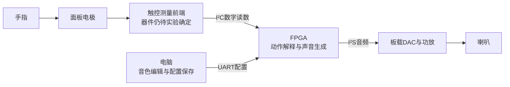

# 项目总览：从手指到声音（2026-10-08）

> 后续增量：逐指连续位置的数字绑定与音高通路已加入，详见 [41-逐指音高接口与待办](41-逐指音高接口与待办-2026-10-08.md)。当前板级包装仍没有真实连续位置输入；本文其余实现状态为该增量之前的总览。

**当前定位：声音计算与事件基础已经较成熟，完整触控交互和实物闭环尚未完成。**
本页综合当前事件修复工作树与6e70会话的首版交互需求/实现追踪；其他分支的本地GUI成果不等于已合入本工作树或通过设备联合验收。

## 1. 我们在做什么

一台以Tang Nano 20K上的FPGA为实时发声核心的加法合成电子乐器：
左手选音/和弦并承担音高表情，右手改变声音分量的强调和音色，电脑负责编辑与保存配置。
最终希望脱离电脑仍能用板上默认配置演奏。电脑不负责生成演奏音频。

目标面板约38个逻辑触点：25个选音、5个音域、8个右手修饰位置；当前不是已验证的38路实体。
完整交互细节仍有待收敛，原型先用2–4个电极。

## 2. 目标链路

这是目标结构，新触控I²C路径和完整动作解释尚未全部接通。现有旧RC路径仍用于基础输入实验。

## 3. 各部分负责什么，做到哪里

| 部分 | 负责的事情 | 当前状态 |
|---|---|---|
| 面板与传感器 | 将手指接触/位置变成可测数字 | 器件、几何、覆盖层待实验；FDC2114是候选 |
| 传感器驱动 | 初始化、读数、检测异常、通信恢复 | 新FDC驱动未完成；原I²C模块仍有v2自检失败，当前顶层未接入外部I²C触控 |
| 动作解释 | 选音、松开、移动、双手修饰的规则 | 基础音符事件已有；新手势与多触点语义仍有缺口 |
| 事件通路 | 将事件按顺序送到声部管理器 | 本轮修复完成：每源4槽，容量内保序，超容量有可读丢弃计数 |
| 声部与合成引擎 | 同时演奏多个音，每个音由多个正弦分量叠加 | 当前32声部×16分量；力度/亮度、包络、滑音/全局颤音基础、效果器已有仿真证据 |
| 电脑编辑器 | 编辑、保存与调用配置，再向FPGA发送 | 另一分支已有本地文件/GUI闭环；完整设备应用及新交互仍需接合验收 |
| 板级输出 | FPGA音频经板载MAX98357A发声 | 当前源码综合/PnR完成；尚未完成本轮实物验收 |

32声部表示最多同时处理32个音，不表示已经做了32个触摸键。16分量决定每个音可以怎样塑造波形与音色。
当前顶层旧RC输入实际只给左手接8个选音位，力度固定12/15，音域条未接物理输入。
代码中存在38位接口骨架，不代表38路传感器已接通。

## 4. FDC2114EVM是什么

- **FDC2114**：TI的一颗4通道电容数字测量芯片，测电容变化，将结果放进数字寄存器。
- **EVM = Evaluation Module**：原厂评估模块，即装好芯片和配套电路、方便做实验的小PCB。
- **FDC2114EVM**：这颗芯片的原厂实验板，含两块示例PCB电极、LC测量网络、参考时钟、MSP430和USB接口及配套软件。
  先用电脑观察传感数据，再按原理图将测量部分接到自己的主控。

来源：[TI原厂产品说明](https://www.ti.com/tool/FDC2114EVM)、[芯片手册](https://www.ti.com/lit/ds/symlink/fdc2114.pdf)。

它负责测量，不直接给出完整演奏意图。手指在哪里、是否换音、怎样影响音色，仍需我们的算法。
它没有代替已有的Tang Nano 20K；评估板上的MSP430主要用于实验时与电脑通信。
一块4通道前端也不能覆盖38点。正式产品需重新决定通道扩展或其他前端方案，不把原厂EVM数量直接当整机BOM。
采购清单只是原厂实验路线的建议，型号还未完成实测选型；没有必要把一份采购清单当成最终设计决定。

## 5. 哪些“已有能力”还不能称为完整演奏功能

| 已有基础 | 还缺少的产品行为 |
|---|---|
| 数字力度影响音量/明暗 | 真实手指力度的感测、标定与输入；电容读数不直接等于压力 |
| 引擎可改变音高 | 普通换音的可靠legato语义、手指连续滑动到音高的映射 |
| 全局LFO颤音 | 左手实际动作控制颤音、必要的触点身份和声部绑定 |
| 可写谱与刷新 | 整份配置受控应用，保持在奏音各自音高/力度/包络 |
| ADSR与参数配置 | 明确的持续/瞬间/混合三种产品方式及操作规则 |
| 右手位图可改谱 | 新的多触点组合、平滑强调、松手保持和恢复规则 |
| GUI文件保存/载入 | 配置完整下发到设备、实体配置槽、整机联合验收 |

这些缺口来自6e70会话的37/42号需求与实现追踪；不是本轮事件修复新增的回归，也不是全部要等待购买硬件才能开始。

## 6. 本轮成果与仍留问题

事件修复实现提交3520270，测试494e278，检查器修正f24aa0a，证据88a94ab。
一次全量50/51（exit=1），仅检查器环境误报；修正后专项PASS（exit=0）。51项硬判据均有通过证据。
当前源码出货顶层PnR：setup +10.218 ns、hold +0.313 ns、TNS 0/0；保留clk_d布线告警。
混响0xC0、I²C v2失败、普通legato触发错位未在本轮修复；I²S相位、触控可靠性和最坏≤10ms仍需实物验收。
截至本页整理，此轮提交尚未推送GitHub。已有代码验证不能证明触摸到喇叭的10ms，也不能证明全部新交互已实现。

## 7. 接下来沿三条主线推进

1. **已有板卡先开工**：用20K、示波器和喇叭验证下载、UART、默认静音、基本发声与I²S；不必等触控EVM才做。
2. **输入原型**：原厂评估板询价后决定采购，先测2个电极，再测4路，记录速度、噪声、相邻移动和长按；通过后再扩到面板规模。
3. **产品交互与整合**：继续实现配置应用、三种发声方式与右手修饰；将输入驱动、GUI与声音引擎合为同一验收版本。

原型通过后再冻结触控器件、正式电极布局与PCB。下一次进度报告按“声音引擎 / 输入硬件 / 演奏规则 / 电脑工具 / 实物验收”五栏更新，避免把不同层的完成混在一起。
