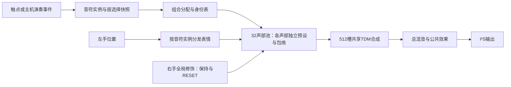

# 四预设音色分层与合奏实现方案 · 2026-10-14

> **2026-10-15用户新增确认**：保留同次演奏的音色分层，同时新增“录好钢琴伴奏→播放→现场演奏弦乐旋律”的不同声部合奏，需求状态**待实现**。它通过已保存伴奏与现场演奏组合，不推定自动生成旋律或完整多轨工作站；音频/事件回放实现和循环/叠录等规则仍讨论中，详见57号§6。下文关于未授权独立声部的旧范围不能覆盖这一新增决定。

状态：**讨论中**。这是依据用户草稿、厂商官方案例与现有源码制定的候选方案；不表示音乐规则已冻结或功能已实现。

需求来源：四种内置乐器预设、四个选择按钮；按一个音高键，可让选中的钢琴与小提琴同时演奏该音。用户本轮授权搜索案例并制定方案，尚未要求修改产品RTL。

## 1. 结论与范围

建议第一阶段做“同音音色分层”：一个演奏音符实例派生多个乐器声部，共享音符起止来源，各自保留预设、力度响应、包络及音色。四层可选择，32声部池及每声部16分量继续保留。

“其他乐器自动提供旋律”分为三种：跟随同音齐奏、依据按住的音组成固定琶音、依据和弦/曲谱演奏独立声部。后两种需要节拍和编配规则，不从用户的同音示例推断已经授权冻结。接口预留事件来源和乐器层身份；首版具体范围待用户反馈。

固定平台为Tang Nano20K；触控、音乐及独立实体可视化由FPGA承担。电脑继续承担获准的配置与连接时可视化，不承担实时音频合成或伴奏算法。没有换板、增加MCU或合并main的决定。

## 2. 官方成熟案例与可借鉴部分

以下事实来自官方产品说明或手册，2026-10-14检索。评价“适合本项目借鉴”是本方案判断，不是厂商对本项目性能的背书。

| 案例 | 官方已提供的功能 | 本项目借鉴点 | 本项目边界 |
|---|---|---|---|
| [Yamaha PSR-E373](https://usa.yamaha.com/products/musical_instruments/keyboards/portable_keyboards/psr-e373/index.html) | Dual Voice将两种音色叠加在整个键盘；Style由根音或和弦驱动节奏、低音与和弦伴奏；另有琶音 | 在产品定义中区分分层、琶音和自动伴奏；同一按键触发多个音色是清楚的起点 | 首版不直接承担整套Style编配 |
| [Nord Stage 4](https://www.nordkeyboards.com/products/nord-stage-4/) | 独立合成器层、每层LED推子和效果区，Layer Scene可切换两套声音设置 | 各层有独立音量和可见启用状态；组合可以保存为一个演奏配置 | 四按钮仍按用户草稿；不因此新增推子、独立效果器或场景按钮 |
| [Roland JUPITER-X](https://www.roland.com/uk/products/jupiter-x/) | 五Part（四合成器、一鼓）；可叠钢琴与弦乐；I-Arpeggio从输入音符、节奏及乐句产生配套声部 | 每个Part有身份；自动生成的音符与直接演奏音符需要分开管理 | 不承诺复现其AI或自动编配效果 |

Roland的[官方用户手册](https://static.roland.com/assets/media/pdf/JUPITER-X_eng05_W.pdf)可作为后续逐Part、琶音开关与保持行为调研入口。本轮未据其定义本项目的按键或保持动作。Nord手册下载本次失败，案例结论仅采用已成功读取的产品页。

这些商用乐器包含采样或其他合成后端。可借鉴声音组织与交互，不把它们的真实乐器音质直接归因于本项目的16分量加法合成。

## 3. 版本事实与实现缺口

阅读入口：38号基线、39号最新设计，以及原样保留的2026-10-11 V1.0设计候选。V1.0原有单一全局修饰、未来双Part预留；本四层草稿属于新增扩展，不能悄悄改写其原文或称已冻结。

本次主目录`fe326ad`基线检查PASS：192输入，无新增/删除/变化；Git工作树有既有文档及诊断等改动。较新整合工作树`C:/Users/Sakuya/.codex/worktrees/66a4/FPGA-Music-project`产品候选07身份检查PASS：241输入。以该候选作为后续实现评估底座，主目录接合仍暂缓。

| 实际源码 | 已有能力 | 本功能缺口 |
|---|---|---|
| `tdm_top.v`、`tdm_engine.v` | NG32、P16、512槽；27MHz/512，52734.375Hz；逐槽频率、幅度与包络 | 多层同一事务的发声边界、平滑抢占需要新增判据 |
| `note_map.v` | 2位全局preset，4×16预设项；同MIDI在奏组优先匹配；逐组力度保留 | 同音不同层及同音不同触点无法用音高区分；缺逐组预设/版本与组合分配 |
| `finger_pitch.v` | 数字位置映射、逐组偏移和防旧指控制重用组 | 绑定时清同finger的旧组，明确“一指只拥有一组”；直接给一指绑四组会把前组解绑 |
| 谱事务、主机配置 | 草稿/发布基础、GUI配置文件、能力门禁 | 当前公共谱需按层的基础谱/映射解释；无四层组合事务及状态回读 |
| `fx_delay.v` | 公共效果通路 | 无四路独立效果链；T60已知问题不能被新混音掩盖 |

当前`gact`表示按键门控，不能直接表示释放尾音已经静音。现有note-off后组可再利用，不保证保留所有重叠尾音。新设计必须说明尾音回收，不能只按32个按住键数宣传容量。

## 4. 预设与按钮候选

四种乐器未定。用于原型的候选为：钢琴式、弦乐/小提琴式、管风琴式、拨弦式。前两种来自用户例子；后两种是便于比较持续/衰减、且适合加法合成底座的建议，需试听选择。弦乐式与小提琴式命名也待试听，不能用名称保证声学复刻。

| 预设候选 | 主要行为 | 重点参数与验收 |
|---|---|---|
| 钢琴式 | 快速起音、按住也自然衰减、松手可阻尼 | 分量随时间衰减、力度与亮度；当前完整Impulse生命周期仍待实现 |
| 弦乐式 | 可配置起音、持续保持、柔和释放 | 连续音高、手动颤音、持续音色；弓噪/弓弦真实感未实现 |
| 管风琴式 | 稳定持续、谐波比例清楚 | 适合作为分层频谱和右手修饰的可测参考 |
| 拨弦式 | 快速起音、高频先衰减 | 推弦候选、松手与尾音；具体乐器待选 |

每个预设的逻辑数据：16项频率比/基础幅度/包络参数、激发与释放策略、力度曲线、基准层音量、右手修饰映射、音高响应。现有ROM项保留；不将全部高级字段一次性变成硬件寄存器。

建议四个按钮各切换对应层启用，LED显示实际已接受的选择；选1层即单乐器，选多层即分层。这样不必先新增“合奏模式”操作。最后一层能否关掉、是否需要独奏快捷动作均待定；不默认把空选择变成隐藏的恢复或停止动作。

建议层选择在新音起音时锁存；切换按钮不重触发或改写旧音的预设及包络。演奏中加入/移除旧音上的层是另一种场景交互，需单独定义平滑策略，不偷偷接入。按钮实际接线、去抖、LED与引脚预算需连同新面板审计，历史38通道不含新增四按钮的已验接入。

## 5. 推荐声音组织

采用一个演奏实例对应1～4组，动态共用32组。不先固定“每乐器8组”，避免只选一种乐器时闲置其他容量。每组仍使用16分量。将多预设幅度直接相加塞入同一组的方案不作为首选：不同包络、频率比和生命周期难以保留；最多作为另一个经过试听的混合音色，不等同独立多乐器分层。

| 选中层数L | 完整按键组合理论容量floor(32/L) | 保留尾音时的含义 |
|---:|---:|---|
| 1 | 32 | 32组含持续音与尚未回收尾音 |
| 2 | 16 | 16个双层实例；重奏会占用/回收旧尾音 |
| 3 | 10 | 2个剩余组不能承接完整三层实例 |
| 4 | 8 | 四层三音和弦占12组；八音和弦占32组 |

层数在演奏中变化时，各实例按自己的快照计数，不用当前L估算全部占用。将“按住键数”“占用声部数”“释放中声部数”分别回读。

## 6. 所有权、起止、抢占与尾音

候选身份结构：`source + contact/note_instance + generation`标识演奏实例，`layer_id`标识其乐器声部；MIDI音高是属性，不再是唯一所有权。generation位宽需按ID循环与挂起事件上界设计，不能靠小计数器无条件防陈旧事件。

声部表保存：实例身份、layer/preset、配置版本、基准音高、起音力度/层增益、按住/释放/空闲阶段和实例年龄。具体压缩布局及RAM推断在资源探针后定；不新增32路并行搜索乘法器。

1. **起音**：先快照层集合及配置版本，检查并预留完整L组；全部成功再发布。资源不足时按选定策略释放/抢占完整旧实例或拒绝新实例，不能只出钢琴却悄悄漏掉弦乐。报告接受/拒绝与原因。
2. **装载**：对各组分别装载对应预设16项，候选目标为各层在同一音频帧生效；现有逐槽待生效机制需先核对能否支持组合提交。若不满足，增加批次发布机制并评估资源，不把顺序装载当原子生效。
3. **移动**：以演奏实例查询所有子组，计算一次音高偏移，再分发到目标组；可比较共享实例偏移与逐组绑定两种资源成本。必须保留旧指不能控制重用声部的判据。
4. **松手**：按原实例查表释放所有子组，不读取当前层选择；各组依其预设进入释放，不强制同一时长结束。
5. **尾音回收**：候选为空闲优先、再回收已松手实例、最后抢占最老按住实例。回收尾音需平滑且可观测；长尾保留与允许尾音截短之间待裁定。为完整无声回收可增加引擎组完成反馈或扫描各槽包络，成本待探针，不用gact==0替代静音。
6. **失效事件**：实例重用后，旧move/off不影响新音；断连、复位、All Notes Off同时清实例和子组状态。

事件队列保留既有四源可靠性修复，保证同一实例ON/MOVE/OFF时序。不可为“OFF优先”任意重排同一实例事件。新增分层在FPGA内展开事务，避免要求主机连发四个同音事件并造成源队列突发；接收确认必须区分入队与实际完成分配。

## 7. 音高、右手修饰和混音

已记载的全和弦修饰、松手保持、可听尾音参与、新音继承与RESET平滑恢复沿用V1.0设计候选。四层如何解释修饰需新增候选规则：同一个全局修饰状态经各层自己的基础谱和映射，作用于全部目标组；不把四个预设覆盖成一份公共谱。逐层选择右手作用范围仍属后续建议，不增加首版现场步骤。

左手候选A：全部层以相同连续音高偏移跟随，易懂且与直接跟手一致；候选B：层按预设选择音高响应，例如钢琴固定、弦乐滑动。B可能形成拍频或不协和，不能仅因像真实钢琴就认定更优。先用A原型试听，A/B均不自动成为用户决定。

每层保留独立起音力度与包络；层增益在现有幅度装载链中计算，优先共享定点乘法/移位，不为四层复制实时DSP。谱刷新、表情变化不能重新起音或覆盖原力度。

候选基础式：`有效分量幅度 = 基础谱 × 力度响应 × 层增益 × 右手修饰`，包络在现有引擎独立演进。明确每级定点位宽、舍入、上限及Nyquist静音。

混音必须对最大实例数、每组16分量及效果反馈联合评估。可按组合预设校准层音量与保守留量；不直接使用1/sqrt(L)宣称防削顶，因为同频相干分量的峰值可能相加。峰值有界不等于感知响度一致。更改组合的增益不能瞬间改变旧音造成音量抽动；旧音锁存与全局平滑方案待选。

先保留公共效果链。各层独立混响、声像和立体声输出不在首版承诺；当前左右槽重复同一样本，GUI左右声像控件不能冒充实体立体声能力。

## 8. RTL、主机协议与数据表改动清单

模块名字是职责候选，实际可优先改现有状态机，避免无必要包装。

| 落点 | 计划改动 | 必须保留 |
|---|---|---|
| `note_map.v`/实例分配模块 | 实例×layer匹配、整组预留/释放/抢占；逐组预设和版本；阶段状态 | 原32组装载接口、力度与释放连续性 |
| `finger_pitch.v` | 一实例多组的表达绑定/分发；重用代次保护 | 单层位级行为、旧指隔离、共时钟竞争规则 |
| `tdm_top.v` | 4位层选择、快照与事务连接、音频帧发布协调 | 512槽/27MHz音频节拍、四源队列 |
| `tdm_engine.v` | 仅在组合发布/尾音完成/平滑回收需要时扩展 | 相位/包络与逐槽样本正确性；不假定无需改引擎 |
| `preset_part.hex`及生成器 | 四种新音色数据与可追溯生成配置 | 旧表留存；表变更属于产品实现，需谱/包络验证 |
| 协议与`dsp_host.py`/`serial_link.py` | 能力位、层选择/增益、实例命令、批次提交、状态/错误回读 | v1.1兼容门禁；不使用未审计寄存器地址 |
| GUI配置/schema | 保存组合、逐层参数、显式Apply、已接受选择与占用显示 | 草稿不自动改设备；模拟模式不能作为音频验收 |
| 输入/约束/构建 | 按钮/LED接线、去抖、引脚、资源及源码身份 | 固定Nano20K；不覆盖旧构建/证据 |

字段候选：`layer_mask[3:0]`、每层预设/增益、`config_revision`、实例ON/MOVE/OFF、应用ACK、实例/声部/释放计数、抢占/拒绝/丢弃计数。先审计协议帧与寄存器空间，再定编码。

公共谱现有覆盖/替换逻辑必须审计：四层基础谱若可独立编辑，需要按层的草稿与发布版本；若先仅固化四预设，仍需使现有全局谱操作不会无意抹去层间差异。配置版本不能覆盖仍被旧音和尾音引用的数据；候选双银行加引用计数/限制提交，耗用及旧版本最大数量须明确。

## 9. Nano20K资源与时延门槛

07归档实测：Logic18751/20736、CLS10048/10368、BSRAM38/46、DSP10.75/24（工具单位），setup+7.378ns、hold+0.198ns、TNS0。剩余1985 Logic、320 CLS（约3.1%）、8 BSRAM。包含观察功能的配置不能等同最终精简产品预算，也不能未经验证移除观察证据后宣称有余量。

因此“复音数够”不是整机资源证明。优先小型RAM表、共享搜索/计算与串行事务；先做实例/层身份及表情分发综合探针，再做包含触控和可视化预算的PnR。不得用扩大NSLOT/提高时钟/换板掩盖容量问题。

样本周期约18.963µs。四层至少需写64个槽参数，但64/27MHz只是写周期下界，不是触摸到声音延迟；还包含搜索、预设读/计算、仲裁、刷新等待、提交和实体扫描。候选层间起音偏差≤1样本；整机最坏触摸到声音≤10ms沿用既有要求，两个指标分别测量。

## 10. 分阶段实施与验收

| 阶段 | 可交付成果 | 状态/进入条件 |
|---|---|---|
| P0 | 本调研方案、音乐规则候选、容量/资源与模块清单 | 本文已整理，设计仍**讨论中** |
| P1 | 两层身份/组合分配/独立预设/完整OFF数字原型与资源探针 | **待实现**；先明确首版范围与试听规则，保留07基线 |
| P2 | 钢琴式＋弦乐式生命周期、左右手表达、混音试听 | **待实现**；P1资源/行为通过后进入；不能只换名称 |
| P3 | 四层启用、配置与协议、GUI、实体按钮 | **待实现**；先通过两层释放/抢占与时序；按钮布线验收另记 |
| P4 | 满载回归/PnR、真实数字PCM、DAC试听、实体端到端 | **待实现/待验证**；分别绑定源码、码流、板与证据 |
| P5 | 固定琶音→根音/和弦规则伴奏→独立旋律 | **讨论中**；用户明确范围后独立排期，现有song_seq只是基础 |

必要行为判据：

- 单层兼容：已有音频黄金参考、事件可靠性、MIDI127、松键连续性不退化。
- 双层/四层：同音多预设的分量与包络各自正确，所有层接受或全部拒绝，帧生效偏差有记录。
- 同音多指：两个同音实例分别松手，旧指移动/OFF不影响另一实例；generation循环/竞争可构造验证。
- 生命周期：钢琴按住衰减、弦乐按住持续，各自释放；重复音、快速OFF→ON及长尾回收无挂音/明显尖峰。
- 容量：L=1/2/3/4边界及超限；三层余2组、混合旧新层数、整实例抢占、拒绝计数准确。
- 表情/刷新：一指多层、组0/31、滑动不重触包络，逐层原力度保持；右手保持/新音/可听尾音/RESET符合最终规则。
- 配置：旧音版本稳定、提交原子边界、连续Apply与版本银行耗尽、模拟/真实后端、协议能力不足与断连恢复。
- 混音：强力度、4层×8实例、16分量及反馈的峰值/溢出/削顶；谱静态核对与真实PCM/模拟听感分别记录。
- 性能：队列/刷新/观察/触控并发的最坏延迟、满载PnR时序及资源；不以平均值或历史PnR代替。

原型自动化测试用数字输入，不冒充实体触控验收。听感比较采用单层与组合的近似等响度对比，记录乐器辨识、起音、持续、释放和遮盖；音色版本随表与参数一起归档。

## 11. 待用户裁定与下一步

最先需要明确的是：首版同音分层，还是同时包含琶音/独立伴奏。其余可在双层原型前后分批讨论：最终四乐器；按钮切换是否只影响新音；连续音高是否跟随全部层；右手全局修饰在各层的具体映射；尾音保留/整组抢占与允许拒绝；最后一层关闭行为。本文建议不自动成为确认决定。

已完成：官方案例检索、现有源码/数据接口/资源证据核对、实现职责与验收方案。未执行：RTL/表/协议修改、综合、PnR、仿真回归、下载、DAC试听或实体接线。本次源码身份检查仅确认版本一致，不证明本功能已验证。未新写或覆盖源码快照。

## 12. 通用乐器框架的五个职责（2026-10-14讲解补充）

用户重申目标是通用乐器框架，并要求讲解事件、生命周期、配置、表情映射与多实例组合。以下为架构解释和候选接口，不因讲解升级为冻结决定。V1.0已有逻辑模块与三种激发语义继续作为依据；四预设是配置实例。

### 12.1 统一事件：动作变成音乐命令

原始触控测量先经识别与校准，再产生NOTE_ON、NOTE_RELEASE、PITCH_UPDATE等音乐事件；键盘/主机/定序器使用各自适配器进入相同音乐接口。输入来源仍须保留，防身份冲突。音符事件携带音符实例与代次、顺序/时间依据及事件所需的值；全局TIMBRE_UPDATE和配置提交携带作用域/版本，不强塞音符ID。可选EXCITATION_UPDATE仅用于有真实数据或明确生成策略的持续驱动，不把RC开关数值假装压力。

MOVE既不隐含NOTE_ON，也不隐含RETRIGGER；再激发需独立定义的明确动作。命令语义不能只有“播放某个频率”，应区分开始、塑造、结束控制与配置变化。

### 12.2 生命周期：控制身份与声音分开

`finger_id → note_instance_id → {voice_id}`；前者是输入接触，中间是本次演奏，后者是分配得到的计算资源。不能只用MIDI音高作身份。

至少分别记录控制状态（接触/已离开）、声音状态（起音/持续或衰减/释放/静音）及所有权代次。钢琴声可能在手指离开前已静音，手指离开后弦乐也可能仍有尾音；两个维度独立。声音静音可释放振荡器资源，但若触点仍存在，需保留轻量音符身份或明确将其标为无声，不能让旧手指误指新分配声部。

NOTE_RELEASE结束输入驱动和控制所有权，不等于马上清零声音。尾音保留最后音高、继续接受既有全局右手修饰，依预设衰减；达到完成条件后回收。组被提前抢占则执行明确的平滑回收。Continuous/Impulse/Hybrid决定驱动和包络演化，不另造三套输入动作。

### 12.3 乐器配置：共享框架中的响应规则

配置回答基础谱、激发、包络、阻尼、力度与表情响应。演奏组合另保存启用层和各层增益，不把一次组合写死进每个乐器定义。活动声部保存运行状态及配置版本引用；不随GUI草稿编辑改变。基础配置变更按明确Apply/新音或平滑更新策略生效；实时修饰保存在独立状态，不覆盖已保存基础谱。

配置是有界参数和少量策略枚举，不要求FPGA执行脚本、通用插件或动态对象。首版共同后端仍是16分量加法合成；新后端只预留职责边界，不承诺无限通用。

### 12.4 表情映射：动作含义稳定，响应可配置

映射链为校准动作→音乐控制量→有界参数→平滑更新。左手相对位置变为该音符实例的音高偏移，再按组合策略传播至子声部；右手连续动作变为全局谱修饰，按各层自己的基础谱与映射计算。音高不重启包络，修饰不重写力度。松手保持、RESET恢复、新音继承与可听尾音参与沿用已有设计。

右手同一个修饰不等于向所有预设写同一份最终幅度；须保留层的基础结构和包络。首个原型可让所有子层共享左手音高偏移；是否按层限制音高为待试听建议，不能默认“钢琴式禁止移动”，V1.0的Impulse允许移动不重新注入能量。

### 12.5 多实例组合：共享一次演奏，各自发声

一指触发C4，产生一个音符实例；组合选择钢琴与弦乐时，分配两个声部，二者共享父音符身份、基准音高与事件时序，保留各自预设、层增益、包络和尾音。两层完成分配后共同发布；MOVE、RELEASE按父身份路由，不按当前按钮选择重新查音高。

另一指也弹C4时必须是另一个父实例。框架需要区分组合配置、演奏实例、子声部这三个层次；“乐器实例”在实现讨论中应明确指配置层还是活动声部，避免对象数量误解。

同音分层属于一个父音符派生多声部；独立旋律伴奏则需要定序/伴奏事件生产者生成新的父音符，有自己的节拍与所有权，可复用后续配置、映射及合成通路。不能靠多实例分配器自动推断和声。

本次main基线PASS（192输入），仅补充设计说明；五职责完整接合及四层行为仍为**讨论中/待实现**。下一步以统一事件/实例身份→双层生命周期→表情分发→资源探针建立最小端到端原型，再细化需要裁定的音乐参数。
