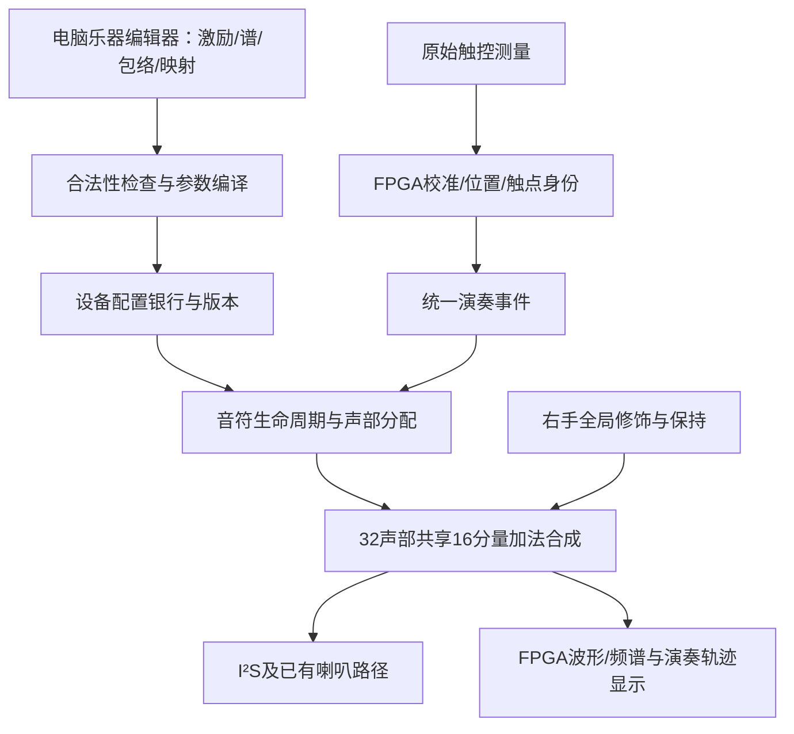

# 通用乐器框架与功能选型定案工作稿 · 2026-10-14

> **2026-10-15用户最新纠正**：取消独立钢琴键结构，保留原两排逐音入口覆盖两个八度，各音位采用滑条，另有一条八度切换滑条；并非改为少数全音域滑条或单条多指。此前助手将布局扩大解释的记载作废。用户要求三版完整选型设计，最新同规格比较见48号；两核心功能、Nano20K与500元约束继续保留。嘉立创选型/PCB接入工作流见46号。25/26个端点位置的差别以预算增量列出，不将旧静态键通道数当原始电极数。

本轮目标：今天收敛最终产品功能、框架与硬件路线。状态按项目用语记录；“用户已选择”指需求决定，不代表实现已验证。未决音乐语义不以助手建议代替。

## 0. 用户确认的两项最终功能主线

2026-10-14，用户明确提出最终功能收敛为：**自定义乐器（包括实时音乐构造与表情）＋音色分层（实现个人合奏）**。据此记录为本轮产品功能主线，实施状态为**待实现**，基础能力仍按既有验证范围说明。

自定义乐器覆盖激励、频谱、时间演化与表情响应的组合，以及演奏中的连续声音塑造；不将其缩减为演前选一份静态频谱。音色分层复用这些乐器定义，由同一次演奏驱动多个独立乐器声部，各自保留配置、力度和包络。四种预设是快捷示例，非框架可定义乐器的总数。

两项结合后的演示判据：编辑/保存一份自定义乐器→独立演奏并实时塑形→选择另一乐器形成分层→多音演奏时各层正确响应音高、修饰及释放。具体层数、面板、配置断电介质与可变参数仍按下文未决项收口，用户这次主线确认不自动批准所有候选数值或器件。自动伴奏不从“个人合奏”推断已确认。

下一步以这两项建立最终功能和参数表，补层间表情作用、起音/释放、保存/应用的明确规则；然后做统一实例身份与双层资源探针。下文此前“分层是否进入首版”已由本次主线确认覆盖；其它建议继续保持待裁定。本次仅设计记录，无产品实现、综合或板验。

## 1. 本轮用户已选择与仍有效约束

| 项目 | 依据与结论 | 实现状态 |
|---|---|---|
| 愿景 | 统一操作下形成多种可辨识音色/演奏行为，同时自由组合创造新乐器；两者都要 | **讨论中**：转化为本稿验收定义 |
| 组合自由度 | 组合激励、频谱、包络和表情映射，保存成自己的乐器 | **待实现**；不要求任意接线/任意反馈图 |
| 左手形态 | 分开的音高键，每键支持连续滑动 | **待实现**；原型电极、几何与算法待验 |
| 新增预算 | 人民币500元 | 作为新增采购上限；尚无本轮报价/下单 |
| 已有/已购 | 显示屏、Tang Nano20K、喇叭 | 用户已确认持有；不等于接口/音频验收 |
| 屏幕已知信息 | “TFT液晶显示屏SPI 3/4线串口 8位16位并口” | 缺驱动IC、分辨率、板型与接口跳线；不能据描述指定初始化/引脚 |
| 固定计算平台 | Nano20K；原有约束：FPGA负责触控算法、音乐、独立实体可视化，不增计算MCU | 继续有效；PC可编辑配置和做获准的连接时可视化 |
| 演奏主旨 | 左手所属音高；右手全和弦修饰、松手保持、RESET平滑恢复 | 既有设计保留，实现未齐 |

38号记录的main不是全部最新成果。main `fe326ad` 192输入基线检查PASS；整合66a4候选07的241输入身份检查PASS。本轮不改产品代码、不合并main、不生成新源码快照。以下资源数来自07已有证据，并非本轮重新综合。

## 2. 最贴近愿景的成熟先例

来源为厂商/作者官方材料，检索日期2026-10-14。成熟指已有公开产品或长期使用的架构，不表示本项目可以直接达到其音质或算力。

| 先例 | 核实的架构特点 | 借鉴及界限 |
|---|---|---|
| [Mutable Instruments Elements作者手册](https://pichenettes.github.io/mutable-instruments-documentation/modules/elements/manual/) | 模态合成，激励器与共鸣器分工；BOW/BLOW/STRIKE激励，少量几何/材料参数生成模态特性 | 最接近“组合产生乐器”的概念；借鉴激励、结构与演奏的分离。现有正弦振荡器不是其被激励滤波器，不直接改名为物理建模 |
| [AAS Chromaphone 3官方手册](https://www.applied-acoustics.com/chromaphone-3/manual/) | 槌击/噪声激励与声学共鸣体；耦合描述共鸣体间双向能量交换 | 配置应描述动态响应，不能只有静态频谱；物理耦合与两个音色相加不同，首版不声称具备耦合算法 |
| [Native Instruments REAKTOR Blocks官方教程](https://blog.native-instruments.com/how-to-get-started-with-modular-synths-for-free/) | 由模块连接构建合成器，声音与控制模块可复用 | 采用可组合定义与统一接口。用户已选择有界参数组合，不需在FPGA实现任意图执行器 |
| [Expressive E Osmose](https://www.expressivee.com/2-osmose) | 连续逐音表达键盘与EaganMatrix模块化声音引擎结合 | 配置不仅决定音色，也决定动作响应；不把其压力传感能力迁移成我们的电容压力能力 |
| [Arturia MicroFreak官方详情](https://www.arturia.com/products/hardware-synths/microfreak/details) | 多种数字声音算法、包络和调制矩阵，在统一硬件控制界面下工作 | 编辑能力丰富，现场可保持有限直观控件；其算法数量和滤波硬件不作为本版必选 |

推导：自己的设计宜采用“稳定的演奏语言＋有界的可组合乐器定义＋共享多声部执行器”。可先在加法合成中承载多种声音行为，再在明确资源和证据后增加后端。四种预设是四份可编辑定义，不是框架能表达的乐器总数。

## 3. 建议的首版架构

编辑器在PC上把用户定义编译为有限的设备参数表；FPGA在脱离电脑时独立执行这些配置。编译基础谱/曲线属于配置工作，不替FPGA算实时音频、触点或独立显示。

### 3.1 最小乐器定义

| 参数块 | 首版候选内容 | 约束 |
|---|---|---|
| 激励 | Impulse、Continuous、Hybrid；瞬态/持续分量的归属 | 三种声音生命周期共用动作；混合先在总16分量内分组，不默认翻倍振荡器 |
| 频谱结构 | 最多16项频率比、基础幅度；整数与非整数比 | 沿用可表示的定点范围与Nyquist处理；新范围需同步表生成/协议/RTL |
| 时间演化 | 各分量/分量组的起音、衰减、持续、释放及松手阻尼 | 实现首版3种生命周期需审计现有包络；不能因字段已保存就称可运行 |
| 表情映射 | 起音力度→音量/谱；左手位移→音高；右手8组→有界谱增益 | 不伪造物理压力；全局位置校准与乐器映射分开；初版不开放任意跨域反馈 |
| 输出校准 | 预设基准增益、峰值约束、公共效果配置 | 不用统一归一化强行抹平力度或包络；效果边界另验 |
| 身份/版本 | 名称、格式版本、硬件能力需求、配置版本、校验 | 草稿、已应用基础定义、实时修饰、活动音符状态分开 |

Hybrid候选是16个分量中一部分瞬间衰减、一部分持续。允许用户决定分组；若要求同一分量同时有两套独立包络，则是新增状态/计算，需要单列资源，不以“混合”名称隐藏。

### 3.2 建议的声音族与四快捷槽

四个实体按钮建议对应四个可替换的设备快捷槽。电脑可保存更多乐器文件，数量由文件管理决定；设备同时常驻槽数与断电保存容量分别明确，不混为无限预设。

建议出厂示例覆盖：钢琴式敲击衰减、弦乐式持续、管风琴式谐波、钟磬式非谐波。拨弦式和混合声音可作为额外编辑器示例文件。四个名字待用户最后选择；全部以“式”描述可表达行为，不承诺采样级真实复刻。

框架验收要能在相同RTL下：改变激励形成持续/衰减；改变频率比形成谐波/非谐波；改变高低分量衰减形成不同声音演化；改变映射深度形成不同表达；保存、应用、重新加载后复现。这比仅展示四个固定音色更能证明通用性。

### 3.3 演奏契约候选

落指创建实例，保持保留控制权，移动改变所属音高但不再激发，离开结束控制/持续驱动并按定义释放。默认键中心音高由键号决定，落指位置作为相对滑动锚点；每键上下滑动是首版候选，不默认支持二维键面。

右手仍作用全部目标音、松手保持、新音继承、尾音参与，RESET平滑恢复。具体面板形态需最后裁定：8条一维修饰滑条便于低成本分区；连续二维面板可实现跨组横移，但会重新引入多指定位/跟踪成本。此前二维方案保留，不将一维建议写成已决定。

键内单触点可以依键号保持身份；同一键上的两指不能靠三电极重心可靠区分。若首版接受每键一个触点，须作为明确能力边界由用户决定；跨键相同MIDI音符与主机同音实例仍应支持独立所有权。左手5指/右手5指是建议验收场景，不是本轮用户已经冻结的数量。

### 3.4 分层与伴奏的定位

分层按42号一父音符多子声部执行；建议保留1～4层目标，四层最多8完整按键实例，含尾音需回收策略。先验证单乐器框架，再实现分层。单声部的Hybrid与多个乐器分层不同：前者共享一个乐器定义，后者多个定义并行。

首版建议不纳入自动独立旋律；定序器入口保留。琶音/自动伴奏需要节拍与音乐规则，用户未明确选定，不能以“通用”无限扩展当日功能。

## 4. 今日功能冻结表：建议与已有决定分开

| ID | 内容 | 定案建议 | 当前状态 |
|---|---|---|---|
| F01 | 通用组合编辑 | 激励＋16分量谱＋包络＋有界映射，自定义保存 | 用户已选择方向，**待实现** |
| F02 | 左手 | 独立滑动音高键 | 用户已选择，**待实现**；键数/滑动量程继承目标并复核 |
| F03 | 右手 | 8组连续修饰、全和弦、保持与RESET | 语义已有设计；实体形态**讨论中** |
| F04 | 发声模式 | 持续/瞬间/混合均纳入框架；先验证前两种 | 建议纳入首版，**讨论中/待实现** |
| F05 | 快捷预设 | 4个可替换槽及选择指示；编辑器更多文件 | 四按钮来自草稿，槽/存储规则**讨论中** |
| F06 | 分层 | 1～4层选择，独立预设/包络/增益 | **讨论中/待实现**，不先于框架 |
| F07 | 复音 | 保留32组×16分量作为资源基线 | 基础内核既有范围**已验证**，完整新功能资源待验 |
| F08 | 力度 | 支持协议力度/配置基准力度；实体真压力另有传感证据才启用 | 不将位置或RC计数当力；候选首版无独立测力传感器 |
| F09 | 自动颤音 | 手动往返为核心，旧LFO缺陷须修才能宣称自动功能 | 自动辅助范围**讨论中** |
| F10 | 效果 | 共享效果链与有界增益；不复制四路 | 已有基础，T60等缺陷仍待修/验 |
| F11 | 显示 | 复用已有屏；轨迹/波形/频谱由FPGA算 | 既有目标，实体**待实现**；不删减为仅电脑图 |
| F12 | 输出 | 先复用板载MAX98357A与已有喇叭；外接LINE OUT候选PCM5102A | 是否本期必须外接输出**讨论中** |
| F13 | 配置持久化 | 电脑文件保存是基础；独立开机4槽建议只读出厂配置，用户写入断电介质另评估 | 可写设备持久化需求尚未裁定；不能宣称RAM槽断电保留 |
| F14 | 自动伴奏/任意模块接线 | 作为未来事件源/后端扩展，不进入推荐首版 | 有界组合已选；自动伴奏最终范围待定 |
| F15 | 性能 | 最坏触摸→声音≤10ms；满载/复位/断连/释放无挂音 | 硬指标沿用，实体**待验证** |

本表是可逐项决定的完整清单，不将用户表达“今天确定”视为批准所有建议。精确滑音范围、右手增益上限/合成规则、触点数量、参数平滑与场景切换细节仍需定数或规定验证调参范围。

## 5. 资源边界与执行方式

2026-10-14后续源码与针对性测试结论见[44号音乐引擎适配审计](44-音乐引擎对通用乐器与分层的适配审计-2026-10-14.md)：不能把当前逐槽独立包络状态理解为起音/释放参数已可独立配置；当前完整定义写入与三激励策略未交付。新增频率安全测试复现截断后漏过Nyquist检查，调制后范围保护也需补齐；本稿开放参数与分层为目标，不直接继承已有内核验收。

07归档配置：Logic18751/20736，CLS10048/10368（余320），BSRAM38/46，DSP10.75/24；setup+7.378ns、hold+0.198ns、TNS0。当前源码身份PASS不等于新框架资源PASS。

采用有限硬件拓扑，编辑器生成表；控制状态用RAM/共享状态机；保留每采样512槽的发声调度。实体频谱与触控并发须联合综合/PnR，不能把8块剩余RAM或320CLS分别承诺给多个功能。若资源不足，先做有证据的共享/复用与观察通路优化，再把需要用户裁定的功能取舍列出来；不私自减少复音、取消三视图或换平台。

## 6. 硬件选型：已选、候选及排除原因

### 6.1 继续使用的部分

Nano20K、已有屏、已有喇叭继续使用；新增采购不重复购买这些。板载MAX98357A为喇叭功放，不是线路输出；两端桥接输出不接地式3.5mm线路输入。屏幕标称“SPI/并口”不能说明模块焊接配置、控制器或实际可用接口，需型号/原理图后在SPI与8位并口之间决定。

[Sipeed官方板卡资料](https://wiki.sipeed.com/hardware/en/tang/tang-nano-20k/nano-20k.html)确认板上音频与显示硬件；不代表用户屏幕已适配。供电、引脚复用、连接器、喇叭负载与显示吞吐须在最终图中核对。

### 6.2 触控器件筛选

| 路线 | 本轮结论 | 原因与证据 |
|---|---|---|
| FPGA原始RC/时间测量＋分区电极 | **预算内首选原型路线，尚未签收成品** | 测量与位置算法由FPGA承担；沿用已有研究基础，但连续位置需重新验。模拟开关可省IO，增加寄生与串扰，必须先小样 |
| AD7147原始CDC读数 | 保留器件备选，不按满12阶段作10ms主选 | [手册表10](https://www.analog.com/media/en/technical-documentation/data-sheets/ad7147.pdf)：decimation64时3/6/12阶段分别2.304/4.608/9.216ms；原始结果可读。增加芯片并行能缩短周期但增加BOM与装配；内部校准不自动满足“算法全FPGA”边界 |
| FDC2114/2214 | 本轮不优先采购全尺寸方案 | [TI手册](https://www.ti.com/lit/ds/symlink/fdc2114.pdf)：13.3/4.08kSPS为单通道连续条件；每片4通道，位置多电极规模下芯片/LC网络较多；不把单通道速率当整机性能 |
| PSoC、输出坐标/ID的触控控制器 | 沿用已排除路线 | 与已有不外包触控算法约束冲突，不为省事重新引入 |

AD7147的12阶段9.216ms是表列扫描时间，已接近全机10ms，更没有给去抖、处理和DAC留足预算；它没有因此被证明在所有其他配置都不可用。

### 6.3 首选原型的具体器件与边界

推荐用于验证的模拟外围：3.3V供电的**CD74HC4067**通道选择、**SN74LVC14A**施密特整形、独立外部RC阻值和必要保护/去耦，FPGA控制充放电/选择并计时。不是读取4067的数字触摸结果，它只是模拟开关；LVC14也不执行触点算法。

依据：[TI CD74HC4067手册](https://www.ti.com/lit/ds/symlink/cd74hc4067.pdf)、[TI SN74LVC14A手册](https://www.ti.com/lit/ds/symlink/sn74lvc14a.pdf)。器件参数只支持电气候选资格，组合成电容测量电路是本项目待验证的设计推断；并非厂商提供的已验多指参考设计。

第一块试验板只做4个独立滑动键，每键候选3电极，共12节点，比较直连测量和经MUX测量。候选材料为铜箔/小电极PCB、可换覆盖膜；先验位置单调性、静止抖动、同时触摸、邻键耦合、功放开关噪声和快速释放，再扩全尺寸。

电极需要交错或其他插值几何，三块任意方铜不保证连续位置。[Microchip滑条设计指南](https://onlinedocs.microchip.com/oxy/GUID-A8A0085D-58D1-4E41-A07D-B93BFDE11AFE-en-US-4/GUID-B4317B09-E80E-4D5C-AD5A-FD6DF7A084B6.html)说明由多个传感点插值及几何的重要性；此处仅借鉴电极原则，不采用其MCU。

规模示例：25音高键×3节点=75；若右手也选8条×3节点，则共99测量节点，另加设置按钮/音域选择。8条并行测量通道各扫描16地址可覆盖128节点；这是规划容量，不是已验接线。候选一整轮≤2ms，若两轮确认则≤4ms，要求每地址含切换/稳定/充放电/读回≤125µs；能否达到由实测RC、MUX寄生、阈值、噪声与同步时序决定。不能用27MHz时钟直接证明达标。

使用外部明确阻值与整形器，避免把FPGA内部弱下拉和输入门限作为已知精密量。输入异步同步、切换后残余电荷、漏电、相邻电极状态、触摸保护与3.3V电平需画入原理图并验证。具体R值、器件片数、完整引脚及PCB不可在测量前伪装为最终签收。

### 6.4 音频与显示

外接LINE OUT若纳入本期，**PCM5102A**为芯片候选；[TI手册§9.3.5.3与表11](https://www.ti.com/lit/ds/symlink/pcm5102a.pdf)列出32/64fs的PLL时钟组合。当前52734.375Hz不是表中列举的标准点，仍需核对工作范围/系统时钟与实测，不能凭“支持384kHz”直接签收。不会为适配DAC偷偷改变采样率及音高表。

已有屏优先按实际可用接口驱动，候选SPI可减少IO，8位并口可提升吞吐但占用更多引脚。绘制轨迹/波形/谱柱采用数据缓冲与按区域生成图形，不默认完整RGB帧缓冲。示例320×240×16bit×20fps=24.576Mbit/s仅像素载荷，屏分辨率未知前不承诺帧率。

### 6.5 用户配置断电保存的器件候选

若用户选择设备断电后保留自定义乐器，建议比较独立**24LC256** EEPROM与板载存储路线。独立EEPROM可避免与FPGA码流Flash区域混用，也无须为少量参数先引入SD文件系统。[Microchip官方产品](https://www.microchip.com/en-us/product/24LC256)、[系列数据手册](https://ww1.microchip.com/downloads/en/DeviceDoc/21203l.pdf)提供32K字节、64字节页写及最长5ms写周期等规格；3.3V使用需按具体料号核对。

实现需16位存储地址、分页/ACK轮询、校验与版本、双份提交和掉电恢复；只在显式保存时写，实时触摸不写EEPROM。音频不能等待写周期。现有I²C模块不因此自动具备完整EEPROM驱动。每槽若预留1KiB，4槽双份为8KiB，再加元数据仍可落在32KiB中；1KiB是布局建议，须由schema尺寸核对。预算从现有前端/预备金额内调配，总额仍500元，未报价/采购/冻结料号。

## 7. 500元预算分配建议

下表为支出上限分配，**不是已核实商品报价或采购订单**。已有三件硬件不计新增支出，运费/耗材包含在总额内。

| 项目 | 预算上限（元） | 用途 |
|---|---:|---|
| 触控原型/前端器件 | 120 | 模拟开关、整形、阻容、保护与小样连接 |
| 电极板/载板制作及装配 | 140 | 小样优先，含返工余量；正式大板成本需报价 |
| 面板/绝缘/固定结构 | 70 | 覆盖膜、底板与安装件 |
| 按钮/连接器/线材 | 40 | 四预设、RESET等最终数量确认后配齐 |
| 外接DAC与线路接口预留 | 50 | 只有纳入本期且能取得匹配模块才支出 |
| 运费/备件/返工预备 | 80 | 不先用满 |
| 合计 | **500** | 报价超限时重新分配或提出取舍，不隐瞒超支 |

逻辑分析仪/示波器优先借用，未到手不宣称完成延迟、电气或音频验收。供应商整板/贴片价格、库存交期本轮未核实；不采用官网千片价估算用户零售价。

## 8. 仍需明确才能签最终版的项目

已可记录的决定是愿景、组合自由度、左手面板形态、预算和现有硬件。剩余须通过具体选择收口：

1. 四出厂示例、四槽与断电保存方式；是否本期纳入分层和独立伴奏。
2. 右手8条分区连续修饰或整面二维；每键一指能力边界及目标触点数。
3. 屏幕控制器/分辨率/实际接口，喇叭规格/插头；LINE OUT是否本期必须。
4. 音高范围/灵敏度、右手增益/保持组合、场景切换/尾音抢占的明确规则。
5. 原始触控小样和整机资源探针结果：决定哪一条硬件路线可成为正式BOM，而不只是一份推荐。

今天可以冻结明确的产品需求、推荐架构及原型器件选择；没有原型数据的连续触控与没有型号的屏幕，不能仅靠文字变成已经验收的最终硬件。文档分别保留决定、实现和验收三种证据，不要求为了“当天定案”降低既有10ms/多指/FPGA独立计算约束。

下一步顺序：收口上面产品选择→最小定义schema和统一生命周期判据→4键测量原型与资源探针→全机引脚/供电/成本表→正式PCB和新源码身份。功能冻结不等于已经实现；物理/时序结果不合格时按失败证据调整并由用户裁定需求变化。
