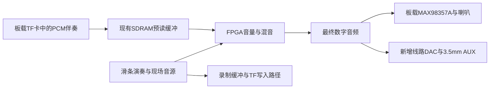

# 录制伴奏与现场合奏：硬件规格规划 · 2026-10-15

状态：功能需求已确认；本文件的硬件/后端与预算分配为**讨论中**，控制器、混音和并行闭环**待实现**。这不是最终采购BOM或制造签收。用户要求规划“录好钢琴伴奏，回放时演奏弦乐”的所需硬件与规格；不自动扩展为无限轨、循环、变速或继续叠录。

## 1. 首选实现路径

建议先按**一路已保存的原PCM伴奏＋一路现场合成总线**规划。录伴奏时直接保存合成后的数字音频；回放时不重新合成钢琴。现场仍使用现有32组共享音源，可选择自定义乐器或同音分层。曲谱指引另用配对事件记录，不从混合音频识谱。

图中录制分支只表示独立录制时的路径，不表示已经决定边放边录或录下最终混音。现场音频直接进入混音器，不经过几秒钟的读卡预缓冲；预读时长不等于现场演奏延迟。回放与现场使用同一音频样本时间基准，分别有状态/停止路径，录音中的音色不会因现场换预设而误变。

## 2. 硬件清单与规格

| 部分 | 规划规格 | 新增采购/实施 |
|---|---|---|
| FPGA | 现有Tang Nano20K / GW2AR-18C；音乐、存储调度与混音在FPGA实现 | 暂不买第二板或计算MCU；联合综合/PnR后决定单板是否足够 |
| 卡座 | 复用Nano板载TF卡座 | 不再买外接TF模块；核实实板版号与接线 |
| 录音介质 | microSDHC 16/32GB，优先32GB；FAT32，C10/U1或更高，正规来源 | 1张；KIOXIA EXCERIA32GB LMEX1L032GG4为厂家型号参考，未取得国内报价/实物资格 |
| SDRAM | 复用芯片内64Mbit=8MiB；建议为录放子系统预留约1MiB | 不加外部RAM；实现SDRAM控制、刷新、仲裁与独立FIFO |
| 板载喇叭通路 | 复用MAX98357A及用户4Ω/3W喇叭 | 不为伴奏再加一个功放；最终混音进入原数字输出 |
| AUX DAC | 3.3V数字逻辑，至少16位输入，明确兼容52734.375Hz和当前串行格式/时钟；可用硬件或可编程配置 | 1套线路DAC及外围，具体料号未冻结；需核PLL、MCLK、位对齐、负载和模拟性能 |
| 3.5mm插口 | TRS：Tip=L、Ring=R、Sleeve=模拟参考地；现阶段两路输出同一单声道节目 | 1个插座＋按DAC需要的耦合/滤波/保护；不是差分喇叭端引出，也不要求耳机直驱 |
| 模拟供电 | 稳定低噪声3.3V支路；先按≥150mA稳压器容量规划 | 具体LDO/去耦按最终DAC确认；已有模块若集成这些，不重复计器件 |
| 操作 | 复用已接受的按压旋钮和显示菜单完成录制、停止保存、选曲、播放 | 不强制新增按键；专用REC/PLAY键可预留，操作细则未定 |
| 参数存储 | 沿用24LC256/32KiB系统候选，保存乐器定义和索引等 | 不用来存PCM；录音本体在TF |
| 整机供电 | 5V、至少2A容量为当前整机规划候选 | 要测两屏、板卡、卡写入、喇叭峰值与压降；不能据表格保证够用，避免USB/外接电源反灌 |

Nano硬件依据：[Sipeed官方说明](https://wiki.sipeed.com/hardware/en/tang/tang-nano-20k/nano-20k.html)。卡型号与FAT32边界：[KIOXIA官方产品页](https://apac.kioxia.com/en-apac/personal/micro-sd/exceria.html)。C10/U1标识不是本项目SPI模式下最长停顿或有效速率保证，厂家峰值读速也不是FPGA主机吞吐；见[SD协会速度等级说明](https://www.sdcard.org/developers/sd-standard-overview/speed-class/)。

## 3. 音频、带宽与缓冲的设计值

保持现有原生采样率，不为方便买DAC或导出WAV擅改引擎时钟：

- 采样率：27MHz/512＝**52734.375Hz**；存储先按单声道有符号PCM16评估。
- PCM数据：**105468.75B/s**，约105.5kB/s；5分钟31.64MB、30分钟189.84MB、1小时379.69MB。仅为纯PCM算例，事件/文件系统另计，不代表已决定最短录音时长。
- 当前数字输出BCK＝**1.6875MHz＝32fs**，左右槽重复同一样本，16位/槽。DAC不能因为“支持I²S”就被判定能直接接上。
- TF初版评估独立SPI模式，工作时钟候选6.75MHz，线速上限843750B/s，实际须减去命令、块头尾、响应和busy。规划连续有效读/写各≥0.5MB/s作为实测目标，并单独记录最大服务停顿；这不是已测结果或卡片厂家保证。
- 单路播放约0.105MB/s；未来若增加同时读伴奏与写新录音，仅PCM约0.211MB/s，还需文件/事件开销。这项只预留核算，不冻结叠录功能。

建议的约1MiB SDRAM预留：

| 用途 | 容量 | 解释 |
|---|---:|---|
| 伴奏预读环形缓冲 | 256KiB | 约2.486秒PCM；实际可吸收停顿小于满缓冲时长，须预留水位/服务余量 |
| 独立录制写缓冲 | 256KiB | 同上；不把一份空间同时全额计算为读写缓冲 |
| 演奏事件队列 | 64KiB | 容量初值；格式、报告频率及满队列策略待验证 |
| 文件/块索引工作区 | 64KiB | 固定范围文件管理的候选初值，不是通用FAT32堆空间保证 |
| 后续余量 | 384KiB | 调整缓冲/索引/异常恢复；不重复分配给显示 |

芯片片内46块BSRAM还要承担音源/效果/FFT，不能拿它直接放几百KiB录音缓冲。建议只用小型片内FIFO解耦音频与SDRAM，由SDRAM承担大缓冲。读卡任务优先满足回放低水位，现场音频保持固定节拍；读空必须标记并平滑处理，不能静默插样后报录放成功。文件布局优先评估连续预分配，以降低碎片和FAT访问开销，但文件系统实现尚不存在。

混音在FPGA实现：两路先扩展到一致定点位宽，各有增益；乘积保留必要精度，双24位满幅相加至少25位，再饱和输出。起停/增益平滑避免人为阶跃；伴奏若已包含录制时效果，不重复经过同一效果链。具体增益范围、用户入口与右手作用范围继续讨论。

计算由`notes/recorded-accompaniment-hardware-20261015/build_plan.py`生成，交付`hardware/recorded-accompaniment-plan-20261015/calculation.json`；算术核对不计为硬件验收。

## 4. 现在不能草率冻结的DAC与引脚

关键规格是**52.734375kHz、32fs及实际WS/MSB关系**，不是最高支持多少kHz。现有I²S发送器注释不能替代按接收芯片时序进行的逐位核验；原数字PCM一致性测试也不证明外部DAC接收正确。

- 常见PCM5102A在原厂手册中有标准采样频率带及±4%检测描述；当前采样率高于48kHz约9.86%。虽然支持16位/32fs与较宽标称采样范围，也**不能据此签收当前工作点**。先核时钟方案与实物锁定、失真/频率；必要时比较可编程时钟DAC，不能擅改音乐采样率。[TI手册§9.3.5](https://www.ti.com/lit/ds/symlink/pcm5102a.pdf)
- UDA1334ATS手册明确audio mode的50～100kHz范围，可用于理解连续采样兼容路线；但NXP已公布该料号停产，**不作为新整机最终采购推荐**。[NXP手册](https://www.nxp.com/docs/en/data-sheet/UDA1334ATS.pdf)、[停产通知](https://www.nxp.com/pcn/201804014DN)
- 本轮立创技能查询PCM5102APWR返回了KH-A2508-03A/C7541714连接器，已按精确MPN不匹配拒绝；没有把其库存/价格填入DAC选型。原始结果摘要见交付`rejected-search.json`。

TF候选SPI用特定官方板版封装脚81/82/83/84（CS/MOSI/CLK/MISO），80/85亦继续保留；这些是FPGA封装脚，不是载板插座编号。TF与两块LCD的候选总线分开。现有音频三线可达J5，但新DAC若需要MCLK/配置/静音脚，应重新核17GPIO载板候选及扩展安排；不得先承诺不增加任何IO。

## 5. 成本边界与验证顺序

已有Nano、TF座、SDRAM、功放/喇叭均复用。卡片暂预留**30元**；已确定的AUX支路（DAC/插座/供电/阻容/保护）暂整体预留**50元**。这是约500元整机预算中的分配目标，**不是报价**，AUX也不是本次伴奏独有的重复开销。电极/载板/屏幕/控制件/面层/结构/装配/运费等仍须按完整BOM实时报价；不得声称总价已经在500元内。

当前核心＋可视化曾综合到19777/20736 Logic、38/46 BSRAM，不含完整存储/双屏/新面板/分层；不能因板上RAM容量足够就保证新增控制器放得下。先按单板规划，联合探针不满足资源/时序/效果后才评估双板，不先购买第二块。

实施顺序：

1. 隔离实现SDRAM读写/刷新/仲裁与TF块读写，测真实吞吐、最长busy与电源扰动；保留原音乐引擎。
2. 加入原生采样率PCM记录/回放、保存提交与错误状态，逐样本核对长度/内容与停止重启后的文件。
3. 接入现场音源与混音，检验同音互不释放、伴奏/现场停止隔离、增益余量及无读卡反压；录后换现场音色不改变伴奏。
4. 加入双屏/触控/参数保存做完整资源与PnR，验证伴奏期间现场最坏触摸至发声≤10ms、音频无丢样，显示忙时仍能演奏。
5. DAC电气与采样兼容、实物音质及真实制造报价闭环，再冻结最终原理图/PCB/BOM。

本轮仅资料、规格、CSV和计算文件，未修改产品RTL/参数/协议/约束或旧快照；未接串口、下载、采购或制造。main HEAD仍`fe326ad9505c94f46f9236bf7f9bfc3b5f1b9a12`，192输入身份PASS。硬件功能状态仍**待实现/待验证**，下一步是隔离控制器/资源验证和DAC时钟资格筛选。
