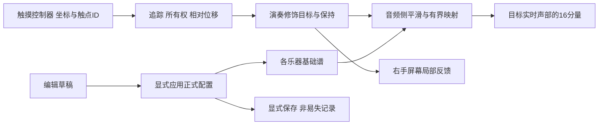

# 成本可行性与右手泛音构造应用审计 · 2026-10-16

本轮为用户要求的核查，未修改引擎、GUI、原理图、旧BOM或制造文件。源码/资料/算式审计在记录范围**已验证**；成本方案**讨论中**，右手目标功能**部分实现/待实现/待验证**，不能当成整机可制造签收。

> **较新代码成果见66号**：用户随后确认左右分侧/高度中点、授权实现，并补充分区不抢触点/范围可调。独立分区推子RTL和交互原型已实现并在数字/浏览器范围验证，8组示例封装独立综合564Logic、0BSRAM。下文“没有推子模块”为本次审计时的事实，不覆盖新增`experiments/right_hand_faders_20261016/`；旧产品引擎/GUI仍未接合新控制器，实体报告/音频映射/平滑等仍待完成。分区硬边界与跨区范围关系仍待明确，原型不作最终规则放行。

> **最新用户决定：附近推子随触点移动**。用户明确选择第一种位置跟随行为，并补充“同一侧两个触点，取最靠近推子的；两边各一个，推子移动至中心”。这取代下文旧V1.0的相对位移/单组独占候选作为当前方向；此前“必须先接近手柄才能接管”未被选择。松手保持/全和弦目标保留。用户规则已记录，状态**待实现**；“两边”是否指竖推子的左右、“中心”是否为两有效触点高度的算术中点仍待确认，不先冻结几何算法。最近距离定义、影响范围和换触点过渡等仍**讨论中**；本轮无实现修改。

## 1. 结论与本轮发现

降本候选值得继续做小样；约558元是附条件的参考模型，500元完整整机尚未证明。最大缺口并不是几颗阻容，而是**成本用便宜并口屏，接口方案用低引脚SPI屏，两者尚未构成同一套经过验证的实现**。

右手愿景与成熟多点触屏方向相容：手指下看见泛音图形、连续修饰全和弦、松手保持、RESET平滑恢复。现有硬件输入仍是旧二值掩码，当前主机画谱/部分应用也不是这一套实体实时手势。基础谱构造、演奏修饰、编辑草稿三个职责必须分开。

保留全部用户目标、7英寸方向、两八度逐音滑条与约500元约束，没有擅自裁决尚未明确的层/回放作用范围或具体音乐映射。

## 2. 成本与制造逐项核查

|项目|当前事实|可行性判断与缺口|
|---|---|---|
|Nexperia C179326开关|HC供电范围涵盖3.3V；TSSOP24；6颗国内公开参考8.94元|可进入替代小样，未证明当前电极/覆膜下RC精度、漏电和噪声合格；不是原SOIC封装直接替换|
|台舟C2841426保护|原厂有四通道/引脚/DFN尺寸及焊盘资料；购25颗参考8.48元|需工厂小封装装配；电容最大0.4pF且为I/O之间测试，漏电10nA测试±2.5V/25°C；3.3V/温度/串扰与保护回路未验|
|约61元下降|26音位例相对原混合参考模型的下降|国内Offer与原国际USD×假设汇率条件不同，数量档/实际下单未核；不能当成已成交节省|
|7英寸屏|最低情景用MRB7966厂家25USD样品EXW×假设7.2=180元|具体国内电容版含运价未得；显示为16位8080，不能接入此前17GPIO的SPI候选即用|
|串并口适配|可研究外部锁存/写时序来压GPIO|目前没有已验证适配BOM/时序/资源/带宽；20元仅敏感度变量，不是报价；SSD1963有显存不等于有SPI主机接口或高层绘图引擎|
|替代SPI模组|MSP7001参考216元，其他带图形控制器模块更高|具体显示/触摸IC、点数、接口版本和整价不全；不能用这个接口的优点配另一个模块的低价|
|供电|用户报告已有5V3A电源|型号/铭牌、整机峰值与USB供电路径待核；不能直接扣掉45元电源/线材/接口合项|
|选择性SMT|用户可焊排针/按键/普通贴片，小封装交厂|分工已明确；100元是预留，仍缺板面积、最小装配数量、钢网/工程/供料/分板实价。板厂生产5片与只装1台的物料数量不能混用|
|载板与演奏面板|保护/RC前端需要靠近电极|小中心板＋长高阻排线可能损害触控，不能只按10×10cm优惠板价算整机；重复排板拼板仍需DFM/报价|
|AUX/TF/EEPROM|保留独立线路输出、板载TF/SDRAM复用、EEPROM参数保存|AUX30元/卡25元等仍预留；DAC须兼容52.734375kHz/现有位时序，不因廉价通用模块而默改采样率|
|结构/运费/小样轮次|40/30/25元等结构、运费、预备费为未报价项|未证明覆盖首次可用整机与研发返板消耗；先作小样降低返工风险，但不能当成总成本已经省下|

**算式复核**：`62.9049部分电子料＋315原未报价预留＋180屏参考=557.9049元`。

替代资格失败的回退敏感度（仍不含实际适配差额）：

|情景|参考合计|
|---|---:|
|两项替代均合格|557.9049元|
|保护替代失败，回原TI参考|599.2417元|
|MUX替代失败，回原TI参考|577.6281元|
|两项均回退|618.9649元|

达到500元的真实条件是：`已落实电源复用节省＋制造节省＋其他实价下降 ≥57.9049元＋新增适配费用＋其他未覆盖成本`。在真实报价前不把这些项写成已节省，也不擅自加预算/取消保护/缩屏或删功能。

## 3. 右手当前设计应如何理解

### 3.1 已确认方向与仍在讨论的细则

**阅读顺序修正**：本节以下相对位移、落指锁组与单编辑所有权是审计时的历史候选；最新用户选择已改为本文顶部的位置跟随及同侧近者/双侧取中规则。不得把旧候选重新实现为默认最终规则。

**已确认目标**：右手有可直接显示泛音图形的触摸区，约7英寸优先；支持多触点、修饰整个在奏和弦、松手保持、RESET平滑恢复。已有无触摸小屏继续作音乐可视化，不能把它误当成右手操作屏。

**候选交互**（来自V1.0，尚非冻结新规则）：横向选控制组，落指锁定组与当前保持值，纵向相对位移增减强调；再落指从保持值开始，避免瞬跳；同组单编辑所有权；失踪触点释放所有权/保留最后可信值。8组映射16分量仅初始方案，数量、曲线、上限、复位范围与手指冲突细节仍需确认。

7英寸示例有效区154.08×85.92mm；8组节距约19.26mm，2mm间隔时净宽约17.51mm。它改善操作空间，但“五点触控”只表示同时最多5个触点，不表示8组必须同时由8指占用；松手保持可先后塑造各组。实际覆玻璃边缘/手掌误触/姿势未实测。

### 3.2 三类数据和两类操作

|对象|用途|应用与保存|
|---|---|---|
|基础谱/正式乐器配置|定义该乐器原本有哪些分量及其幅度、激励/包络等|显式编辑与应用；显式保存后才要求断电保留|
|演奏修饰|当前右手给基础谱增加的实时强调/形状变化|目标为实时生效、松手保持；RESET只撤销修饰，不删除保存的乐器|
|编辑草稿|尚未提交的构造内容|可以自由画谱，包括将零分量改为非零；保存草稿不等于设备应用，也不等于写入设备非易失存储|

因此“右手构造乐器”与“右手演奏表情”不是同一个写入操作。演奏强调已有分量时，基础幅度为零不能凭空长出分量；进入编辑草稿则可从零构造新基础谱。实体Edit→选槽/按压旋钮和屏幕页面应明确显示所处模式、目标槽、未应用/未保存状态；页面具体流程仍**待实现/讨论中**，不能把当前PC工作台空闲应用限制当成最终实体规则已定。

### 3.3 合理的应用路径与当前缺口

这是职责方案，触摸→声音不能等待屏幕画完，亦不经PC串口作为实体必经路径。控制值、屏幕反馈和音频采样分开调度。屏幕优先显示目标/保持值及手指反馈；最终有效谱可受平滑/限幅影响，若只显示目标值应标明，不能拿FFT能量图当作可编辑的配置谱。

同一控制组应映射到各音符自身的分量，不能误当固定Hz频段：例如修改三度和弦中每个音的第3分量，而不是在整段混音中提升同一固定频带。分层时各乐器保留自己的基础谱，不可为方便刷新而全部换成同一张谱；修饰所有层还是选中槽、每槽映射是否不同等细则仍未冻结。

### 3.4 当前源码实际到了哪里

本轮读取主机`ca03`工作树和引擎`instrument-engine-safety`，没有只看main旧源码。具体路径/行号/哈希见`hardware/cost-right-hand-audit-20261016/source-review.json`。

|功能|源码事实|当前状态|
|---|---|---|
|旧物理泛音输入|`tdm_top.v`将上8个二值pad与0x5B按位或；`note_map.v`命中时直接取255|旧能力**已实现**；不符合连续强调/零分量不生成/松手保持目标|
|16项谱事务|`cmd_spectrum`草稿→16值→提交；旧开发页可再显式全刷/单组刷|基础能力**部分实现**；整谱提交不等于整个和弦同采样点原子更新|
|当前工作台部分应用|`workbench._apply_document`会拦截按住音符/当前活动音及曲谱播放，预设/谱设置后提示下一次起音使用|**部分实现**；不能称实体演奏中连续塑形已完成|
|完整配置应用/设备断电保存|当前11版明确只部分应用预设与谱，其他字段仍草稿；PC文件保存不写EEPROM|**待实现**|
|当前刷新范围|引擎`ST_RFCH`只遍历`gact`组；保留原力度，使用起音tag区分刷新与重奏|有底座；释放尾音可能已不在`gact`，不能宣称所有可听尾音必然更新|
|触摸屏专用接合|本次受查RTL/主机未找到GT911/SSD1963/新右手追踪与映射模块；存在旧独立I²C资产不代表已接入|本轮受查范围**待实现**，不是对全部历史目录绝对不存在的断言|
|每组保持/RESET/平滑|未见目标触点所有权、保持状态、独立修饰层及复位链路接合|目标**待实现**；不沿用旧“松手回中”|
|分层独立配置|共享谱/预设能力不等于每层独立基础谱与四层同时发声|**待实现/部分实现**，按42/44及后续整合版本验证|

当前PC普通编辑可以继续用于构造/试听基础谱；实体实时右手功能需要专用控制与音频适配，不能简单把触摸坐标接到0x5B，或连续调用PC“应用”按钮替代。

## 4. 流畅度与资源边界

1. **GT911延迟**：汇顶当前官方列5点、I²C、100Hz。名义周期10ms，再加先前五点I²C理想读取/清状态1.1925ms，在不利相位模型下已约11.1925ms，尚未含传感处理/调度/音频。它不是实测最坏值，但足以说明100Hz宣传不能证明最坏≤10ms。59号已有厂家手册周期配置线索，实际面板配置和端到端测量仍需核；不自动放宽10ms或宣称GT911绝对不可能更快。
2. **屏幕更新**：800×480 RGB565整帧768000B；按原6.75MHz串行逐像素传输，理想整帧910.22ms、约1.10fps，20Hz每轮原始载荷最多42187.5B且尚未扣命令/共享总线。需屏侧显存＋局部变化/控制器绘图，不能每次拖动上传整屏。SSD1963虽有1215KB显存和窗口写入，仍须发送像素，不能按RA8875/LT7686高层图形命令能力代算。串并适配写重复颜色的优化可以评估，但尚未实现或验证。
3. **操作/显示分离**：I²C读取与声音控制优先，显示可分块让出总线；RC前端、移位锁存和已有小屏共享串行资源时必须可仲裁，整帧传输期间阻塞扫描会破坏演奏延迟。旧ILI9341可视化的20Hz是另一模块的目标/已有有限仿真，不能给新7英寸操作屏继承性能证明。
4. **PC串口不是实体控制后端**：当前全谱事务19次写＋全刷1次＝40字节，115200/8N1仅发送就约3.472ms，尚未算USB/主机调度/回读/引擎装载。此算式不能证明10ms，也不要求实体音色控制走UART。
5. **FPGA联合资源**：既有核心＋可视化综合19777/20736Logic，约剩959，BSRAM38/46剩8；这不是包含新触屏/录放/分层的最终资源。新触摸控制状态本身较小不等于渲染/存储/DAC/调度一定能放下；需要隔离模块再联合综合/PnR，不据此立即加第二板，也不能保证单板已满足全部目标。

## 5. 回放与操作规则的剩余边界

已确认录好伴奏并播放、再现场演奏独立旋律。若用候选PCM回放，文件已是混音音频，右手不能直接按其中每个音符的16分量重塑；这需要事件轨重合成或另外设计音频处理，不能把已有PCM解码当成具备该能力。

建议首版优先讨论右手作用于现场实时乐器，PCM伴奏按录下结果播放；这是实现建议，**不是本轮替用户作出的新决定**。伴奏是否随右手变化、全部实时层/选槽范围、可听尾音和新音继承规则、编辑应用对在奏音的影响，均需用具体音乐例子收口。V1.0已有新音继承/尾音修饰候选，不因旧实现缺少而撤销目标。

## 6. 下一步与验证范围

建议顺序：先确定一条可接合的7英寸整屏路线（具体IC/触点/接口/时序/总价含适配）→隔离模拟触点测试所有权/相对位移/保持/复位/音频状态不重触发→前端小样及实际触摸报告/端到端测量→联合综合/PnR与供电/总线干扰→真实选择性装配报价→最终制造放行。具体音乐细则先讨论，独立驱动/资源探针不必等待这些细则全部冻结。

主目录HEAD `fe326ad9505c94f46f9236bf7f9bfc3b5f1b9a12`，main192身份检查PASS，0新增/删除/改变。新脚本仅导入主机帧生成器做离线计数、不调用串口；11个受查源文件读取前后哈希相同。已有成本资料审计再次PASS；本轮没有新功能测试、仿真、综合/PnR、接硬件、声音/触摸/供电/ESD测试或采购，没有改旧源码快照。归档验证与本轮只读核查分别记录，不能把此文状态或算式检查当目标功能PASS。

当前重新浏览的主要来源：[MRB7966模块参数](https://www.lcdwiki.com/7.0inch_16BIT_Module_SSD1963)、[模块原理图](https://www.lcdwiki.com/res/MRB7963/7inch_SSD1963_display_Schematic.pdf)、[SSD1963原厂手册（模组厂家托管）](https://www.lcdwiki.com/res/MRB7963/SSD1963_DS_V1.1.pdf)、[Goodix官方触控规格](https://www.goodix.com/en/product/touch/touch_screen_controller)、[Nexperia原厂手册](https://assets.nexperia.com/documents/data-sheet/74HC_HCT4067.pdf)。价格仍沿63/64留存的公开读取证据，本轮不伪称取得新国内成交报价。
