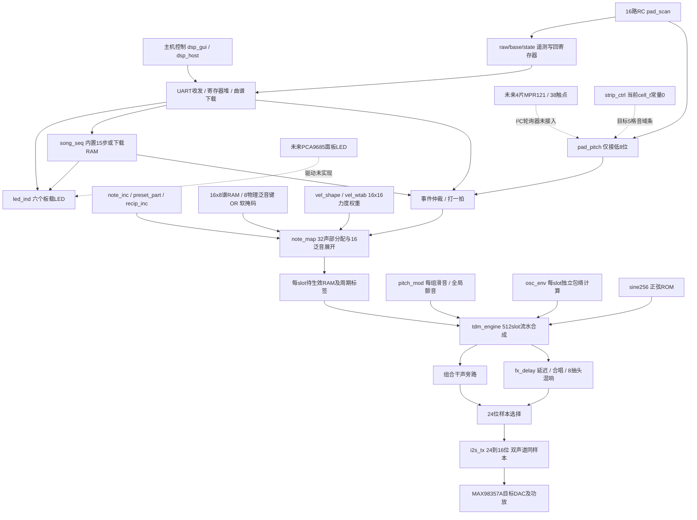
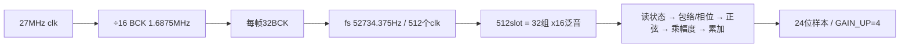
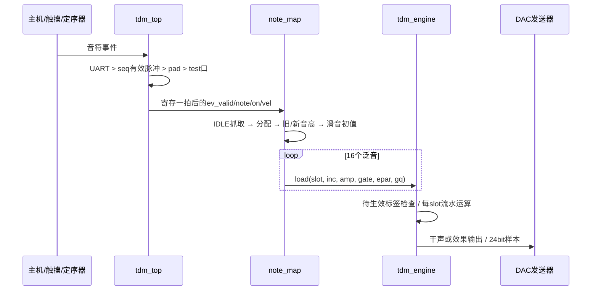
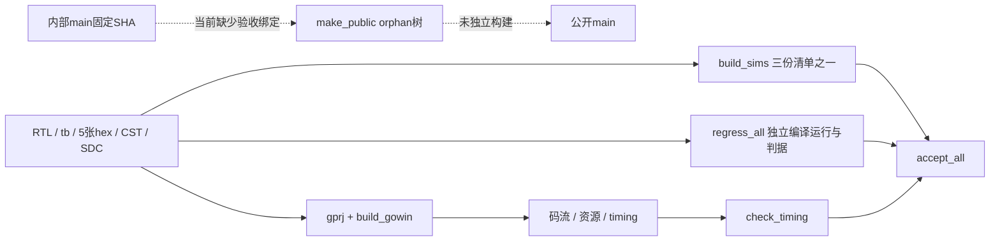

# 源码逆向架构（2026-10-06）

基线 `90e891d`。本图由Gowin工程、RTL例化和脚本反推。实线是当前产品链；虚线是未来接入或离线验证。审计发现见[33号报告](../02-技术方案/33-全项目与Git审计-2026-10-06.md)。

## 1. 整个工程的五层

必须把两个“独立”分开：32个声部/512个振荡状态独立，计算硬件则共享。每声部有16个泛音状态；不是实例化512套乘法器，也不是播放512条录音。谱、相位增量、正弦ROM都是合成参数/函数表，库内wav是离线展示产物，不在RTL播放路径中。

## 2. 真正的编译边界

产品工程是 `src/gowin/tdm_synth/tdm_synth.gprj`，器件GW2AR-LV18QN88C8/I7。它登记18份RTL、CST和SDC。此次综合日志确认最终顶层是 **tdm_ship**。

| 层 | 模块 | 契约/职责 |
|---|---|---|
| 出货封装 | tdm_ship | clk/rst、UART、6LED、DAC4线、16pad；把测试事件、preset、test_mode固定为0 |
| 产品集成 | tdm_top | 参数切片、自举、遥测、事件源和装载源选择，连接合成/效果/输出；不是仅一层薄包装 |
| 输入 | pad_scan、pad_pitch、strip_ctrl | 物理测量与去抖、音符锁存与扫描、档位确认；strip当前常量输入被优化掉 |
| 控制 | uart_rx、uart_tx、reg_bank、song_seq | 字节收发、两字节解帧、128字节寄存器、内部/下载曲谱定序 |
| 配置展开 | note_map、vel_shape | 32组分配；一条音符事件展开16次load；预设+谱+力度生成幅度和包络参数 |
| 合成 | tdm_engine、pitch_mod、osc_env | 每slot的phase/inc/amp/env/stage/gate/epar与待提交存储；共享计算流水；每组滑音和全局LFO |
| 输出 | fx_delay、audio_clk_en、i2s_tx、led_ind | 音效、采样/串行时钟使能、DAC数据、面板提示 |

当前输入 `pp_touch={30'b0,pad_state[7:0]}`，所以只有通道0..7能触发音高；pos上电为1，MIDI为48..55。高8位pad仍直接塑谱，未通过38路新映射的harm_mask。pad_scan原来的带busy排队事件输出仍存在，但产品改用pad_pitch输出后不再消费它。

`tdm_top`外部事件端口是仿真便利接口，产品封装把它关掉。不能把测试台能直接输入ev_note，解释成板上还有这些排针事件输入。

## 3. 时序、数据与存储

- 计算状态机都以27MHz `posedge clk`推进；sample_en、bck_en是使能。BCK/LRCK是输出波形，不是RTL内部新时钟域。
- 24位相位增量是频率/采样率×2²⁴；正弦表256项，每项16位有符号。
- 32声部固定分组，g占slot `16g..16g+15`。音符展开通过约20拍状态机，逐拍写16个slot。
- 引擎提前LAT=4个slot取地址，经读状态、包络/相位、正弦、乘法、累加构成流水。**实际代码在sc=LAT=4重新开始累加，sc=LAT−1=3锁存上一轮完整和**（`tdm_engine.v:864,889`）；计数回绕仍为512拍。头部“sc=0清/511锁存”是过期注释，不能照抄为当前时序。
- 每slot有phase/inc/env/stage/amp/gate/epar；待生效区保存新inc/amp/gate/epar/gq和valid/奇偶标签。**当前仅做到逐slot消费，跨边界16次load不保证整声部原子生效**，这是审计R7。
- 当前顶层env开启，attack=117；decay/sustain从预设epar来；release等其余全局参数为常量。每组滑音保留gq，颤音是全局LFO，尚无逐声部触后。
- 内部24位音频经高16位截取送双声道同值；README的“24位数据”描述内部位宽，线上实际是16位/声道。
- 输出时钟由FPGA生成，所以产品是I²S时钟控制方，目标DAC接收时钟。当前i2s_tx的位对齐需修，见R1。

### 五张权威数据表

| 文件（src/gowin/tdm_synth） | 消费者 | 内容 |
|---|---|---|
| sine256.hex | tdm_engine；并行参考也用其副本 | 256×16bit正弦函数采样 |
| note_inc.hex | note_map | 128×24bit MIDI相位增量 |
| preset_part.hex | note_map | 4×16×48bit；ratio_q8/amp/epar |
| recip_inc.hex | note_map | 128×20bit倒数，音符装载时计算滑音初值 |
| vel_wtab.hex | vel_shape | 256×12bit存储，使用低9bit；地址={4bit力度,4bit泛音} |

运行时0x6D的非零值只启用力度权重表，0x6B/0x6C保留；不是按寄存器实时生成整张表。改hex需要重新构建码流。仿真运行目录必须带数据副本；旧sim_build表不是权威源。

## 4. 控制平面与音符生命周期

事件源仲裁目前是优先mux，无确认或FIFO；note_map忙时事件丢失。相同音符先命中旧gtab，随后查FREE，再round-robin；held/release/idle没有完整分离。谱刷新只刷gact为1的组，使用全局当前preset/谱及最后的力度。这些行为解释了为何单个音符测试能通过，但和弦、松手、长期连续演奏出现缺陷。

| 寄存器区域 | 真实路径 |
|---|---|
| 0x00 | 测试、颤音、滑音、音色来源选择 |
| 0x0F | 请求回读，TX回地址和值两字节；忙时不排队 |
| 0x30–0x37 | 颤音相位/深度、滑音步长、音色 |
| 0x40–0x49 | 效果启用、长度、反馈、LFO/混响参数 |
| 0x50–0x54 | 定序使能/保持、tempo、力度；曲谱源由0x73长度决定 |
| 0x58–0x5B、0x63 | 谱写指针/值/模式、8bit软泛音掩码、刷新触发 |
| 0x60–0x61 | NOTE_NUM与NOTE_TRIG写入触发 |
| 0x64–0x6A | 16路RC遥测raw/base/state与选择器 |
| 0x6D | 力度谱形开关 |
| 0x70–0x73 | 下载曲谱音高、拍数、索引、长度 |
| 0x7F | 版本0x10；当前reg_bank并未强制所有“只读语义”地址只读 |

自举、UART、遥测共用寄存器写口，优先顺序自举>UART>遥测。自举保证出货上电参数；寄存器initial与自举两份定义需要保持一致。用户复位并不会重新执行Verilog initial，当前各层复位契约不完整。

## 5. 软件、实验与遗留边界

| 文件族 | 与产品的关系 |
|---|---|
| tools/host/dsp_gui、serial_link、theme、build_exe | GUI/通信/打包；SerialLink连FPGA，SimLink只模拟寄存器与遥测 |
| tools/scripts/dsp_host | REG/Frames/CLI，GUI复用地址和帧结构 |
| synth_engine/additive_tool/render_wav/tdm_demo等 | 离线参考、激励生成与音频渲染，未加入板上音频生成路径 |
| osc_core/osc_additive/mixer/synth_top | 全并行黄金参考，用于证明TDM数学和流水对齐；不在tdm_synth产品工程内 |
| osc_additive_top/test_mode | 旧并行产品与实验路径；TDM测试模式在tdm_top内自行装512频率栅格 |
| perf_ctrl/sensor_sim/tb_perf | 通用传感器交互骨架及仿真；当前产品top没有实例化perf_ctrl |
| i2c_master/mpr121_model/tb_i2c_master | 未来触摸控制器接入实验；未进入产品工程 |
| bringup_9k、LCD/image/video、led_blink | 独立板卡/显示演示；不是当前乐器实时可视化链 |
| rtl/archive、_fix/_diag脚本 | 历史方案与一次性维护工具，不能按名字推断其仍在产品中运行 |
| docs/01、03、PROJECT_MEMORY、notes、refs | 赛题/学习/历史过程和证据；需与可执行源码版本交叉核对 |

旧并行项目也复用了reg_bank，而该模块已改为TDM地址默认表。R0直接驱动引擎，不证明旧并行顶层上电语义仍兼容。这就是共享模块改动与“黄金参考仍绿”之间的验证边界。

## 6. 构建与验收依赖

反向追踪时顺序应是：当前source SHA → gprj顶层与真实例化 → 端口/寄存器映射 → 调度和状态存储 → 独立输入输出判据 → 当前综合报告 → 板级电气实测。旧文档的架构提案、历史wav和提交摘要不能替代其中任何一项。
