# 最终产品外形参数

> 2026-10-24 建。汇总分散在 4 份文档里的尺寸，**并把互相冲突的数字摆出来**。
> 状态：**全部未冻结，未做机械配准**。不能用于外壳开孔、投板或采购结构件。



## 1. 一句话结构

产品是**三件套**，不是一块板：

```
左手电极面板（独立件，含 24 个音位触点 + 音域条 + 泛音键）
        ↓ FPC / 线束
载板 140 × 100 mm（Nano20K 插在上面，6 条扫描通道 + 音频 + 电源）
        ↓
J10 七英寸触控屏（右手泛音构造区）
```

关键点：**84 个电极装不进 140 × 100 mm 的载板**。24 个 12 × 48 mm 的触点按 18 mm 中心距排，单排就要 216 mm。所以电极面板必须是独立的一件，载板只做控制器。

## 2. 参数总表

### 2.1 载板（PCB）

| 项 | 值 | 来源 | 状态 |
|---|---|---|---|
| 外形 | **140 × 100 mm** | `hardware/current/context/REGIONAL-WORK-IN-PROGRESS.json`、`AUTONOMOUS-CURRENT.md:170` | 暂定，未机械配准 |
| 层数 | **4 层** | `REGIONAL-WORK-IN-PROGRESS.json`（"140x100mm four-layer board"） | 实际工程 |
| 板厚 | 1.6 mm | `purchase-master.json:886` | 采购假设 |
| 铜厚 | 1 oz | 同上 | 采购假设 |
| 阻焊/表面 | 未定 | — | 待定 |
| 元件数 | 227 件（215 SMT + 12 通孔），36 料号 | `current-board-procurement.json` | 原生核对过 |
| 安装孔 | 四角 M3，中心距板边 ≥ 5 mm | `30-PCB布局需求单.md:20` | 旧方案，需按 140×100 重算 |
| DRC 状态 | 47 项未连通 / 13 网 | `AUTONOMOUS-CURRENT.md` | **未投板** |

### 2.2 左手电极面板

| 项 | 值 | 来源 | 状态 |
|---|---|---|---|
| 音位触点 | **12 × 48 mm**，中心距 **18 mm** | `62-七英寸…布局评估:74`（2026-10-15） | 示例值，未冻结 |
| 触点间距 | ≥ 3 mm | `26-电极面板装配指南:42` | 设计约束 |
| 两排净高 | **108 mm** | `62-七英寸…布局评估:74` | 示例值 |
| 每排位置数 | 13（12 音位 + 1 端点） | `25-音高与八度规格:19` | 端点数待定（25/26 争议） |
| 音域条 | 5 格，20 × 30 mm 并排 | `26-电极面板装配指南:45` | 未冻结 |
| 泛音键 | 8 个，15 × 30 mm | `30-PCB布局需求单:35` | 未冻结 |
| 面板总尺寸 | **约 250 × 220 mm** | `26-电极面板装配指南:46` | **旧值，与 470×220 冲突** |
| 面层材料 | 未定 | — | 待定 |

### 2.3 右手触控屏（J10）

| 项 | 值 | 来源 | 状态 |
|---|---|---|---|
| 尺寸方向 | 约 **7 英寸** | 用户 2026-10-15 提出 | 已确认方向 |
| 模块包络 | **185 × 108 mm** | `62-七英寸…布局评估:74` | 候选 |
| 有效触控区 | **154 × 86 mm** | 同上 | 候选 |
| 厚度 | 7.98 mm（Surenoo SSP0700A） | `62-七英寸…布局评估:65` | 单型号 |
| 分辨率 | 800 × 480 | 多个候选一致 | — |
| SKU | **未冻结** | `PRODUCT-SPEC.md` R03 | 待定 |

### 2.4 整机

| 项 | 值 | 来源 | 状态 |
|---|---|---|---|
| 空间提案 | **470 × 220 mm** | `62-七英寸…布局评估:70`（10/15） | **提案，非机械图** |
| 高度/厚度 | 未定 | — | 待定 |
| 外壳 | 未设计 | — | 待定 |
| 重量 | 未估算 | — | 待定 |

## 3. 三处必须知道的冲突

这三处数字在不同文档里不一样。**下表左侧是当前有效值**，右侧是旧值，不要混用。

| # | 项 | 当前有效 | 旧值（已作废） | 判定依据 |
|---|---|---|---|---|
| 1 | 载板外形 | **140 × 100 mm** | 260 × 200 mm（`30-PCB布局需求单:17`） | 140×100 是 10/23 实际工程板框；260×200 是 10-06 前按 24 个大触点估的 |
| 2 | 音位触点 | **12 × 48 mm，中心距 18 mm** | 15 × 40 mm（`26-电极面板装配指南:41`） | 62 号（10-15）晚于 26 号（10-06），且 12×48 才能把 13 格压进 216 mm |
| 3 | PCB 层数 | **4 层** | 2 层（`purchase-master.json:886`） | 四层是 U9ControlWork 实际重铺层数；2 层是采购询价用的旧假设 |

第 1 条还有个连带问题：`30-PCB布局需求单` 里的「四角 M3 + 板中央补 2 个」是按 260×200 设计的，**140×100 上需要重新算安装孔位**。

## 4. 仍未冻结的项

1. **25 还是 26 音位**：A 条顶端格（C4）与 B 条顶端格（C5）是否独立发声
2. **整机 470 × 220 mm 是否成立**：这是纸样阶段的提案，未做双手姿态实测
3. **面板 250 × 220 与整机 470 × 220 的关系**：旧面板尺寸放不进新整机提案，两者需要重新对齐
4. **载板与面板的连接方式**：FPC 还是排线，弯折半径与固定点未定
5. **外壳材料与厚度**：亚克力 / 铝 / 3D 打印，均未评估
6. **屏的最终 SKU 与整机开孔**：185 × 108 是模块包络，实际玻璃可能超出 PCB

## 5. 相关文档

| 文档 | 内容 |
|---|---|
| `docs/02-技术方案/25-音高与八度规格.md` | 38 通道表、音符公式、音域档（契约） |
| `docs/02-技术方案/26-电极面板装配指南.md` | 触点编号 A1–A12 / B1–B12 / C1 / S1–S5 / H1–H8 |
| `docs/02-技术方案/30-PCB布局需求单.md` | 电极几何约束、接地网格、测试焊盘（板框尺寸已作废） |
| `docs/02-技术方案/62-七英寸右手触屏选型与整机布局评估-2026-10-15.md` | 470×220 布局提案、屏候选比较 |
| `fpga/current/PITCH-MAP-DEFINITION-20261024.md` | 电极 → 通道 → 音符 → 声部的映射定稿 |

## 6. 这张图能用来干什么、不能用来干什么

**能用**：讲清三件套的相对位置；向队友/评审说明产品形态；估算线束长度与走线方向。

**不能用**：外壳开孔、结构件下单、投板、宣称机械设计已完成。图中所有尺寸都带「提案」或「暂定」标记，且示意图非等比。
