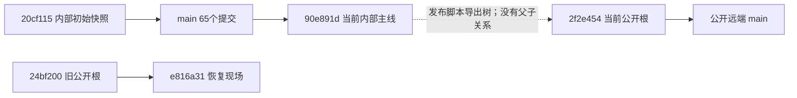

# 全项目与 Git 审计（2026-10-06）

审计基线：`90e891db4c0d3e086889d9ccd476bae4e9e16266`。审计开始时工作树干净，当前是 Codex detached worktree。结论针对该提交；本次只新增审计材料，不修改产品 RTL、发布脚本或 Git 分支。

**项目已经形成可综合的 FPGA 合成链，但还不能把“门禁绿”解释为完整乐器可上板验收。** 本次独立模型确认 I²S 格式不符合目标 DAC，顶层和弦事件会丢失；还发现声部生命周期、谱形刷新、Nyquist 和复位缺陷。内部主线备份已同步；公开版发布链缺少隔离和可追溯性。

配套：[源码逆向架构](../04-架构图/06-源码逆向架构-2026-10-06.md)、[复现与证据](33-审计证据-2026-10-06/README.md)。严重度：P0 为阻断核心音频/演奏；P1 为重要功能或验证/发布可靠性缺陷；P2 为局部工具、尚未接入功能或文档问题。这里的 P0 是工程优先级，不代表安全漏洞评级。

## 1. Git：真实仓库拓扑

| 项 | 实际结果 |
|---|---|
| 内部主线 | `main = internal/main = 90e891d`，65 个提交，首提交 2026-10-04 |
| 公开版 | `public = public/main = 2f2e454`，2026-10-05 15:45:11 +08:00，独立根提交 |
| 恢复分支 | `repair-20261004 = e816a31`，父节点为旧公开快照 `24bf200`，也与 main 无共同祖先 |
| 当前工作树 | detached HEAD；主工作树占用 main，另有 `.baseline_check` detached worktree |
| 远端实查 | `git ls-remote --heads internal/public` 分别返回上述 main SHA；不是只依据本地 tracking ref |
| 远端别名 | `internal` 指向内部仓库；`origin` 与 `public` 指向同一个公开仓库；main 的 upstream 是 internal/main |
| 对象完整性 | `git fsck --full` 完成，无 missing/corrupt 对象；存在 12 个 dangling blob，不等于数据损坏 |
| 工作树元数据 | `git count-objects -vH` 报一个零字节 garbage 路径，位于共享 `.git/worktrees/.../refs`；本次未删除它 |
| 源树规模 | 审计基线 452 个跟踪文件；公开版 188 个；36 个 RTL 文件、41 个 tb 文件；Git pack 约 12.55 MiB |
| 发布标识 | 没有 Git tag；没有保存 main SHA → public SHA → 验收证据的发布映射 |

图中的虚线表示发布工作流，不表示已证明 `2f2e454` 来自哪一个内部提交。当前脚本未保存源 SHA，无法单靠父节点精确追溯。

`git diff public...main` 会失败：没有 merge base。查看两份树应使用 `git diff public main`；把 `public..main` 的提交数量当成“公开版落后多少提交”也不准确，因为公开根独立。两份树共同存在的文件有 10 个内容不同，其中包括 `tdm_top.v`、`note_map.v`、Gowin 工程、协议和回归脚本；后续新增的 `pad_pitch/strip_ctrl/led_ind/vel_shape/vel_wtab` 也不在这份旧公开快照中。完整共同文件差异清单见证据 inventory。

### 1.1 版本演进与 Git 能证明的边界

| 阶段 | 历史证据 | 对架构的意义 |
|---|---|---|
| 9 月设计与初版实现 | 仅见历史文档、存档 RTL、证据文件；Git 从 10 月 4 日开始 | 不能把文档日期当作对应源码的 Git 版本；原始开发过程已被首提交压成快照 |
| 10 月 4 日初始库与公开整理 | `20cf115`、`fb70550`、`7d57166`、`09278ff` | 产品、验证、文档一并入库；公开整理曾损坏 Python 缩进，回归又曾因退出码被掩盖而误判 |
| 10 月 5 日核心修复 | `f593d63`、`daa97da`、`2be9cfd` | 湿声符号/饱和、事件源仲裁、寄存器地址、曲谱源语义修复 |
| 10 月 5 日发布现场恢复 | `ff9e49b`、`1797fad`、`65cd073` | 多次把落在 public 上的改动取回 main；发布脚本增加返回分支兜底 |
| 10 月 5 日输入演进 | `68de404`、`5272a57`、`e03b22a` | 加入 38 通道映射、音域条、LED；顶层仅接入旧 16 pad 的一部分 |
| 10 月 5–6 日验证修补 | `5200930`、`f0a5ded`、`6558773`、`ff92477` | 缺表、缺宏、重复或遗漏源文件登记，暴露三份独立构建清单的维护问题 |
| 10 月 6 日力度谱形 | `f3d9662` → `a92c125` → `90e891d` | 公式改 ROM，处理时序/初始化位宽；加入单元与集成判据 |

**提交信息要与树内容逐条对照。** `90e891d` 写“12 f1 内联拷贝漏 vel_wtab.hex 已修”，但提交 diff 没改 F1 分支：`regress_all.py` 的 F1 路径仍手拷四张旧表，没有调用 `copy_data()`。因此这条提交信息只能证明意图，不能证明 F1 修复落地。

本次full运行目录也确认缺这张表，F1最终仍通过512峰判据：测试模式绕过了note_map演奏装载路径。这证明F1通过不能替代依赖完整性检查，不能用它证实该提交说明里的修复。

### 1.2 发布与暂存流程风险

**G1 / P1：`make_public.py` 在活动工作树内切换 orphan 分支和清空索引。** 已有 `public` 分支时 `checkout --orphan public` 直接失败；在 Codex detached worktree 中，finally 把 HEAD 状态改成 main 的尝试还会与“main 被其他工作树占用”冲突，而且 subprocess 返回码被忽略，仍打印已切回。`--dry` 也执行 finally 的 checkout；在独立测试库 detached HEAD 上已复现 dry 后切回 main。普通命名分支上的 dry 保留原分支，不应笼统说所有 dry 都切换分支。

每次重新生成orphan根也无法普通fast-forward到已有公开main；脚本打印的普通push命令不能完成第二次发布。需要明确选择持续公开历史，或受控替换快照并保留每版映射，本次没有执行任何推送。finally的分支查询/checkout还没有统一使用cwd=ROOT，从其他目录启动时恢复目标可能不对。

**G2 / P1：发布复核只有打印，没有失败阻断或构建验收。** 在隔离的合成测试库中，README 含一个 PAT_A 命中，脚本仍返回 0 并提交快照。该关键字检查本身只是内容筛查，不能代替秘密扫描、依赖完整性、仿真或综合。公开版也没有独立干净构建验收、源 SHA、工具版本、参数和证据索引。

排除表把“审计文档”硬编码成22号文件名，不会自动排除本次33号报告、证据或以后新增的内部审计材料。未来公开导出前必须明确这些新增材料的发布范围；本次没有修改该策略或发布它们。

**G3 / P1：`git_precheck.py` 是暂存变更工具，不是只读审计。** 即使不传 `--commit`，它也 `git rm -r --cached .` 和 `git add -A`，覆盖调用者精心挑选的暂存范围；首条 rm 的退出码没检查。必须文件表未包含 `tdm_ship.v`、`tdm_engine.v`、`sine256.hex`、`vel_shape.v`、`vel_wtab.hex`。本次未在真实仓库执行这两个可变更 Git 的工具；发布脚本复现在隔离测试库完成。

**G4 / P2：双远端别名增加误推空间。** main 的 upstream 正确指向 internal，但显式 `git push origin main` 会把内部树送向公开仓库。当前没有证据证明已经发生这种误推。建议取消歧义别名、保留明确 internal/public 名称，并让发布操作只接受已经验收的导出 SHA。

建议发布工作流：固定内部源 SHA → 独立临时 worktree/导出目录 → 按明确规则生成文件树 → 关键依赖和构建验收 → 写 source SHA/工具与参数/证据清单 → 生成公开提交 → 更新版本 tag 或发布记录。是否保留公开历史还是每次独立快照，由项目决定；不要在导出工具里自动切换正在施工的工作树。

## 2. 产品 RTL：独立复现的缺陷

| ID / 优先级 | 触发与结果 | 根因与位置 | 修复应证明什么 |
|---|---|---|---|
| R1 / P0 | 标准 I²S 接收模型将恒定 `0x1234` 解为 `0x2468` | `i2s_tx.v:77–97` 在 WS 换声道后第一个上升沿已经给 MSB；`tb_i2s_tx.v:124–130` 同样从该沿开始收，闭环相互迎合 | 独立标准模型同时验证正负样本、左右不同数据和边界；再用逻辑分析仪核对 DAC 输入 |
| R2 / P0 | 强制顶层同时出现 8 键触摸，`seen=0xFF`，实际 `active=0x03`，只接收 2 音 | `pad_pitch.v:83–104` 每拍发单周期事件并立即记 seen；`tdm_top.v:656–698` 无接收确认；`note_map.v:378` 只在 IDLE 收事件 | 来源各自保留未确认事件；处理 busy 与仲裁冲突；4/8/25 键 on/off、刷新期间松手不得丢失或挂音 |
| R3 / P1 | MIDI60、vel8=64 的首泛音装载幅度 50；note-off 后重装幅度 200 | `note_map.v:338–339` 关门分支改用未乘力度的 `amp_src`，也绕过 vel_shape | 松手只改变门或保持该声部实际频谱和幅度；弱奏释放不得跳响 |
| R4 / P1 | 先弱奏60，再强奏64；全刷时声部60首泛音从 50 变 187 | 刷新态 `note_map.v:399–415` 没恢复每声部力度，使用最后一次事件的 `vel_cur`；当前无每组力度/音色快照 | 逐声部保留必要参数；刷新只改变请求修改的轴，不串用其他音符力度 |
| R5 / P1 | 持续按60，依次按放61..91，再按92；31 个声部未按住，却把 slot0 的60替换为92 | `gtab` 关音不归 FREE；搜索不结合 `gact`，所有历史标签占满后直接 round-robin | 区分 held、release、idle；优先回收空闲/尾音，不能在有空闲候选时抢占 held；重复音符和释放尾音语义也要定义 |
| R6 / P1 | MIDI108 第16泛音：完整增量 21308176，截断后4530960，`nyq_kill=0` | `note_map.v:292–294,328` 先截成24位再比较，超过一个采样周期的泛音回卷到 Nyquist 以下 | 用完整乘积判断频率越界再截断；覆盖全部 MIDI×预设×泛音及调制后的越界 |
| R7 / P1 | 在引擎 sc≈504 开始写同组16泛音，消费出现在 epoch2 与 epoch3 | `tdm_engine.v:786–795` 给每个 load 分别打周期标签，没有整组事务提交；流水提前访问还影响周期归属 | 定义组提交边界；扫遍512种起始相位，16泛音在同一音频帧生效，而不仅是各 slot 各自同步 |
| R8 / P1 | note-on60 后拉低再释放 rst_n，`note_map.active` 恢复成 `0x01` | `gtab/gact` 只在 initial 初始化，复位分支未清；引擎多数状态 RAM 也不随按键复位清零 | 区分上电初始化与用户复位；复位结束须静音且分配表、门、包络、待提交区一致 |
| R9 / P2 | 音域条先按cell0 9/10阈值再直接移至cell4，2拍后已换档；随后直接移cell2保持完整阈值仍不换档 | `strip_ctrl.v:48–64` 不跟踪候选 idx，onehot连续有效时沿用旧 hold_cnt/committed | 每个候选格独立持续满100ms；跨格移动重计时，已提交后移动可再次提交；当前顶层常量绑死，尚不影响现有板级输入 |
| R10 / P2 | GUI 请求地址与返回首字节不一致也接受数据 | `serial_link.py:160–177` 只取 r[1]，没有核对地址，异常路径也没保证恢复 timeout | 拒绝错地址/残留帧，明确短包与超时恢复；与 FPGA 回读吞吐限制一起验证 |

R2 复现使用层次 force 提供“扫描已完成后的触摸位图”，检验数字事件通路，不声称模拟了真实电极物理过程。R7 是针对 engine 装载接口的受控边界测试，不是板上已测故障。R8 确认分配表状态没有复位；真实声学复位行为仍应结合板级 DAC 和完整引擎清零验证。

R1 规范依据：NXP [I²S bus specification §3.2](https://www.nxp.com/docs/en/user-manual/UM11732.pdf) 要求 WS 提前一个 bit-clock 宣告下一字；ADI [MAX98357A/MAX98357B 数据手册](https://www.analog.com/media/en/technical-documentation/data-sheets/max98357a-max98357b.pdf) 区分 A 的 I²S 与 B 的左对齐。发方用下降沿、收方用上升沿解决的是建立/保持，不等于“延迟一个完整 BCK”。这是当前源码注释和接收模型共同误解的地方。

## 3. 构建、门禁与证据可信度

**V1 / P1：干净 checkout 不能直接执行 README 的 build_sims 命令。** 23 个目标中22个因输出目录不存在报 `Code generator failure: -1`，退出1；唯一已有目录 audio 的目标成功。只创建目标父目录、未修改源代码后，重跑23/23编译通过。缺陷位置 `build_sims.ps1:76–93`：输出前未 mkdir；还依赖当前目录和固定 `D:\iverilog`。不能把这次编译失败解释为22处 RTL 语法错误。

**V2 / P1：门禁不能保证仿真失败必然标红。** `regress_all.py` 在08、09多轮、10、12、14、full-mask等路径忽略部分 run 返回码；08与full-mask目录未清空；清空失败被容忍；copy_data缺表静默跳过；`compile_and_run` 对 TIMEOUT 会返回 log 而非统一报错。各判据强度不同，一些仍可能被旧产物或部分日志迎合。本次没有人为制造生产目录污染；这是可指向具体控制流的静态缺陷。

**V3 / P1：源码清单和测试入口分叉。** Gowin工程、build_sims、regress_all各自维护。build_sims只有23项，而仓库有41个tb；新pad_pitch/led_ind/I²C/vel单元并不全在该编译入口。回归默认14个结果项，full预期31项，不能再叫12组。latency、E8、pad集成、Nyquist、T60、GUI等并未全部作为该回归的必过运行判据。编译覆盖不等于行为覆盖。

**V4 / P1：综合总入口也可能接受旧产物。** build_gowin取得 `$gwExit` 却不判断，成功依赖输出中无 ERROR +找到任意旧 `.fs`；SynOnly甚至不检查产物。check_timing 的fresh只表示90分钟内，没绑定本次起始时间或源码SHA；accept_all的 `-Project` 也未传到时序文件选择，仍检查固定tdm_synth。当前这一轮确实重新生成了码流和时序，不能据此否认工具控制流风险。

**V5 / P2：GUI 自测落后于协议裁定。** 本次 GUI 自测退出1，只有定序器项失败：产品实际发 `SEQ_CTRL=0x01`，自测在 `dsp_gui.py:1220` 仍期望0x05。功能已跟随 A6，坏的是测试预期与残留注释；不能再把旧归档 GUI PASS 当成当前提交证明。

**V6 / P1：当前全量回归的09 regctl已判红，LED期望仍沿用旧协议。** 09的音符起/落分别9/8次，在奏11990样本中11984个非零；唯一报错是LED序列太短，实际提取 `[1,2,4,2]`。`reg_ctl_check.py:271–286` 仍按 `MIDI & 0x1F` 计算期望，而 `led_ind.v:71–85` 已改成音高带one-hot。因此这条失败是集成判据未跟随LED规格，不应误修回旧RTL显示方式。

证据应同时记录 source SHA、工具版本、编译宏、文件清单/hex哈希、命令、退出码、起止时间、判据和原始日志。旧文档、提交摘要、旧wav展示都只能表示对应时点，不自动覆盖后续RTL改动。尤其 I²S 旧模型自洽、R0只覆盖共享数学、F1走测试模式，都没有覆盖本次演奏输入与释放生命周期反例。

## 4. 当前实现、规格与物理完成度

| 功能 | 当前可证明的实现 | 尚未接入或未验证 |
|---|---|---|
| 合成 | 512 slots，32×16，24位相位/输出，16位DAC数据，52734.375Hz | 核心数字链存在上述缺陷，不能由吞吐数替代可闻复音证明 |
| 音色 | 4份preset ROM；16×8谱RAM；8物理泛音键与软掩码OR；vel_wtab编译期权重 | 新亮度轴、触后逐声部颤音和完整模拟量输入未实现；0x6D仅作非零启用，不是连续倾斜增益 |
| 包络/表情 | 每slot包络、每组滑音、全局颤音；顶层attack/release等仍为常量 | 0x01–0x0E为释放区，不能声称GUI支持完整运行时ADSR旋钮；每声部表情设计见31/32号规格 |
| 触摸 | 16路RC扫描；低8位映射到MIDI48..55；高8位塑谱；力度固定12/15 | 38路/25音高键/5格音域条/4片MPR121是目标设计；顶层pp_touch补零，strip输入常量0 |
| I²C/面板灯 | i2c_master及模型/测试存在于库中 | 不在tdm_synth工程、没有轮询器接入top、PCA9685面板LED没有实现 |
| 指示 | 6板载LED由led_ind驱动 | strip_ctrl被综合优化移除；规格里的面板灯不等于已占用物理输出 |
| 控制 | UART115200，两字节写帧；0x0F回读；下载曲谱 | 没有帧头/校验/半帧超时重同步；回读忙时新请求无排队，需要主机节流 |
| 硬件 | 本次Gowin重新出码流，CST审查通过 | 板卡采购/电极RC量程/标准DAC实测/端到端物理延迟尚无本次实测证据 |

README仍记13690逻辑、+17.372ns、12组回归和旧输入介绍。SDC/CST、GUI注释也保留旧46875Hz/五声音阶/0x05等口径。以实际连接和本次产物为准；架构图同样必须标识“当前连接”与“提案”。

引擎头部“sc=0清累加、sc=511锁存”也与实际代码不符：当前是sc=4起累加、sc=3锁存，用来对齐LAT=4流水（tdm_engine.v:864,889）。本次架构说明按代码表达，未把旧注释当成事实。

时序静态检查还存在覆盖边界：SDC仅一个37.037ns主时钟和rst_n false_path，没有DAC外部建立保持约束；源码未找到所声称的复位同步释放链。UART有双级输入同步，pad的异步阈值采样和复位释放需要单独核验。PnR有PR1014时钟路由警告；本次报告同时将clk_d列为PRIMARY，不能只根据一条警告推断整个主时钟没有走全局网络。

## 5. 本次验证台账

| 检查 | 结果 |
|---|---|
| Git status、refs、remote实查、fsck、树差异 | 完成；主线远端同步；公开根独立；无对象损坏 |
| Python AST | 125个已跟踪Python文件可解析；不表示其运行行为全部正确 |
| build_sims 干净目录 | 1/23成功，退出1；补输出目录后23/23编译成功，退出0 |
| Gowin重新综合+PnR | 成功，顶层tdm_ship；Logic14781/20736，BSRAM31/46，DSP9/24，I/O30；CLS8744/10368 |
| 本次SETUP | +15.229ns；check_timing --require-fresh退出0；这是当前数字时序证据，未覆盖DAC协议正确性 |
| CST脚本 | PS6通过；这是约束文本检查，未替代板卡电气实测 |
| GUI离屏自测 | 退出1，定序器测试预期仍为0x05 |
| 现有补充单元测试 | tb_pad_pitch与tb_led_ind通过；tb_i2c_master三项失败（进程仍退出0），尚不能将I²C实验接入产品 |
| 自建针对性反例 | R1–R9中数字反例均已复现；原始日志、输入脚本见证据目录 |
| 全量回归 --full | **30/31通过，退出1**；唯一失败09 regctl旧LED期望；VP7、512峰F1、16组TDM掩码/包络比对、两个力度套件均通过 |

本次未烧录、未推送、未执行真实仓库的发布或重暂存工具。综合器和GUI改写的原有用户配置/截图/自测报告在留存本轮副本后恢复，使产品树保持原样。

F1本轮谱外能量1.99%，最大峰位误差1.61Hz；16组黄金参考均0/2495不符，固定对齐延迟5拍。这些支持合成计算链和测试模式本身，但不能否证前述真实演奏路径反例。回归结果已保存至证据目录regress_result.audit.txt。

## 6. 处置顺序

1. 先修R1标准I²S与R2带确认的事件通路；让“真实DAC能正确解码”和“至少4键并发且松手不挂音”成为必过入口。
2. 统一声部状态模型：力度/音色快照、释放参数保持、空闲回收、重复音符、暖复位；依次覆盖R3/R4/R5/R8。
3. 修完整位宽Nyquist判定和整组提交，扫全音域与全部512种事件到达相位。
4. 从干净clone修构建目录、源/数据唯一清单和严格返回码；补标准接收、pad集成、GUI、E8、延迟、Nyquist等运行门。
5. 把公开导出移到隔离目录，先完成源SHA绑定和导出树验证，再决定发布历史策略；随后同步README、协议与架构图。
6. 最后接38通道I²C传感器和面板灯，并按硬件原型结果冻结表情与PCB。保留已验证的合成数学作为回归基线，但避免它替代产品生命周期验证。
