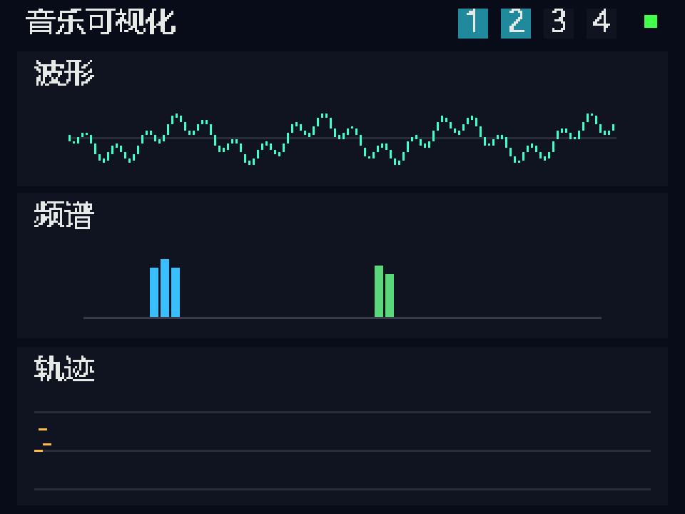

# 音乐可视化独立模块 · 2026-10-15

> **性能复核增量**：用户认可预览后要求确认最终效果指标。`metrics/metrics-summary.json`补充4轮保守接口压力与分析计时：最长绘制51.721ms，50ms压力门槛未全通过；5ms短音可能漏轨迹；FFT实际约47.64Hz、波形为每50ms约9.71ms快照、频谱自身满高回落约900ms。没有改RTL或引擎。20Hz为目标与原双音工作负载结果，不是已签收的全负载稳定效果。详细指标/改进顺序见项目55号报告。

状态：**部分实现**；下述数字仿真和联合综合范围**已验证**，实际屏幕与产品接合**待实现/待验证**。新代码仅在本目录，未覆盖 main 或最新引擎工作树；没有下载码流。



这是引脚接收模型重建的画面，不是实屏照片。`simulation.gif` 为连续8次更新、约0.4秒的测试片段；轨迹只积累了8列，不代表整条历史只能画8列。

## 显示内容

- **波形**：实际输出PCM16的128列min/max，每列4个样本；保留短脉冲，固定幅度标尺，青色。
- **频谱**：实际PCM的1024点Hann窗FFT，48个近似对数频带；快起、逐帧缓降。蓝色到金色对应频率从低到高。使用相对对数L1幅值，不是校准dBFS/功率测量，也不是泛音预设柱图。
- **轨迹**：32个已接受声部的音符/连续音高事件，金色；高音在上、低音在下，时间向右，每50ms增加一列。288列约14.4秒后循环覆盖。这里只表示按音控制状态，释放尾音仍在声音波形/频谱中体现。
- 顶部1～4显示选中预设层；绿色点表示已经收到FFT结果。首版不包含实体乐器编辑菜单。

目标屏幕：用户确认的 **YT240L008N、ILI9341、无触摸**。按ILI9341的横屏320×240、RGB565、4线SPI实现；SCK约6.75MHz，满足v1.11写周期≥100ns。厂家[YT240L008系列页](https://www.eya-display.com/yt240l008/)列出240×320、8080/SPI及多种控制器变体；N后缀、实际接口绑带/FPC/转接板、供电与专用初始化仍需实物资料核对。不能仅凭系列名给40针排线直接接线。

## 接入接口

顶层为 `rtl/music_visualizer.v`，其余5个 `.v`、`mv_font.vh` 和4张 `*1024.hex` 一并加入工程。默认27MHz，无新时钟域、无音频反压。所有输入输出同步于clk，复位低有效。

| 端口 | 契约 |
|---|---|
| `pcm_valid` / signed `pcm[15:0]` | 实际送往I²S的PCM16；每个真实音频样本脉冲一次。现有核心为27MHz/512=52734.375Hz。不是每个时钟都重复送同一样本 |
| `layer_mask[3:0]` | 设备已生效的四层选择状态；界面不改变合成器 |
| `base_note[6:0]` | 轨迹窗口最低MIDI音，显示至base+24；范围外不绘点。可随音域档位设置，切换不会改变引擎音高 |
| `note_valid/on/id/number` | 声部分配器实际接受的开/关事件，id=0～31；抢占/重用后新note-on更新该id |
| `pitch_valid/id/pitch_q8` | 该声部已生效的绝对MIDI音高Q8，例如C4=MIDI60时为15360；不能直接传手指位置或频率比例 |
| 音符/音高事件并发 | 此版pitches RAM的note-on写入优先于同拍pitch写入。接合适配器需保存并串行发出观察事件，不能为了显示反压音频事件；当前联合探针没有实现这个适配器 |
| `lcd_reset_n/cs_n/sck/mosi/dc` | 逻辑信号；暂无CST/背光控制/电平转换配置，不能直接当已批准的接线表 |
| `transfer_done` | 本次局部绘制的SPI字节已发送完毕 |
| `update_done/rendered_frames` | 本轮50ms调度周期结束。它是遥测边界，不是液晶原子换帧/TE同步 |
| `late_frames` | 局部绘制超过本轮50ms预算的累计次数；源事件/音频不等待它 |
| `analysis_gap_samples` | FFT忙时没有进入下一分析窗的样本数。只跳过分析，不丢弃引擎音频 |
| `spectrum_sequence` | 已完成的分析窗计数，可用于诊断数据更新 |

FFT每窗连续采集1024个样本，变换期间跳过分析输入并计数；不声称每个音频样本都参与频谱。波形双缓冲，单次捕获约9.71ms，绘制期间前台缓冲固定；下一次波形捕获提前进行，因此20Hz不等于20Hz以内的数据年龄。当前没有跨整个波形、FFT与事件的共同采样时间戳。

`engine_probe/` 是**隔离复制的综合/对照工程**：只在复制的tdm_top增加两个只读观察输出，原始版本另存为tdm_top_reference。实例tap为`sample_en`和`audio[23:8]`，与I²S采样边界一致。探针保留逐指表达，但关闭板诊断及电脑连续观察；层状态固定1、pitch更新接零，只连接已接受开关事件。它不是最终实体顶层，也不代表连续滑音、四层合成、实体编辑已经接合。

## 验证与实际资源

证据在 `verification.json`、`delivery-audit.json`、各仿真日志、两个 `impl/gwsynthesis/` 报告中；精确身份以JSON内SHA-256为准。本目录为未提交实验增量，声音底座来源a7427ed（交付683db48），main仍为fe326ad。

| 检查 | 实际结果 |
|---|---|
| FFT数学对照 | 静音、DC、单音、双音、负满幅共5组；512个正频率bins/组；独立NumPy浮点FFT的最大复数误差≤9.235 LSB，限值12；单音峰16、双音峰8/37；包含连续valid和忙时计数 |
| 波形 | 5组×128列：静音、正/负满幅、交替极值、短脉冲；源暂停及复位中止通过 |
| 完整界面引脚仿真 | 196394字节、2071个合法窗口、8轮更新；实际接收端核对像素数量、静态区域不变、和弦/改音高/释放轨迹；缺字节和越界两种破坏记录均被拒绝 |
| 调度和传输 | 周期间隔50.0014ms（测试时钟18.519ns半周期的舍入所致）；此双音工作负载late=0；启动后各轮实际绘制约6.36～11.08ms，首轮完成边界约659ms |
| 引擎隔离对照 | 1505012周期、2939音频样本（2914非零）、233767个LCD SCK沿、2次FFT、6个实际note事件；512栅格测试及三音开关；PCM24和I²S/状态逐拍完全一致 |
| 单独模块综合 | 2968/20736 Logic，1659寄存器，7/46 BSRAM；DSP原语MULT18X18×1、MULTADDALU18X18×3 |
| 核心＋模块联合综合 | 19777/20736 Logic（约95.4%），7552寄存器，38/46 BSRAM；动态接口，无物理IO/PnR |
| 源码与备份 | main192、最新引擎246输入校验PASS；备份CRC/内容/哈希通过；备份main297文件逐项未变 |

隔离音频对照按时钟周期验证逻辑一致性；该测试用100MHz仿真时钟和缩短的屏幕初始化等待加快执行，不能作为屏幕时序或27MHz物理时序证据。独立完整界面测试使用27MHz及真实初始化等待。

20Hz是当前局部更新设计目标和上述工作负载的实测结果，不承诺任意最大变化输入均无超时；大面积变化需继续做最坏负载预算。液晶GRAM逐块写入，无TE同步/双显存，不把稳定遥测节拍说成无撕裂60fps。没有联合PnR、实际排针约束、实屏点亮/颜色方向/背光/观看效果、完整触控与编辑/分层/存储资源签收，也没有新增板级触摸到声音延迟证据。约4.6%的综合逻辑余量不能承诺完整产品装入，更不能仅凭此判定必须购买双板。

## 复现

本机有Icarus和Gowin；不下载或安装工具。需要带NumPy/Pillow的Python。完整仿真可能耗时几分钟：

```powershell
& 'C:/Users/Sakuya/.cache/codex-runtimes/codex-primary-runtime/dependencies/python/python.exe' 'C:/Users/Sakuya/FPGA-Music-project/experiments/music_visualizer_20261015/run_validation.py'
```

`--check-existing`先检查已绑定的源码/记录SHA-256，再复核原有结果，不重复仿真；`--engine`额外重跑复制引擎对照。`verify.py`自身也检查编译产物与输入的新旧关系，修改RTL后必须重新编译/仿真。

`prepare_synthesis.py`与`prepare_engine_probe.py`只写本目录下的复制工程；随后使用各目录的`synth.tcl`运行Gowin综合。联合探针需要保留的50号核心副本。不要把探针里的抽象端口批量映射为实体IO。

## 备份与下一步

备份位于 `../../notes/backups/20261015-085907-before-music-visualizer/`：`main-source.zip`、`latest-engine.zip`、`display-experiment.zip`与`backup-receipt.json`。如需恢复，先解压到新目录比对，不直接覆盖用户当前工作树。

下一步先核对实物模块接口/初始化，再在独立板级包装中分配引脚、接观察事件适配器，完成联合PnR和实屏色条/三视图测试。选型和制造继续暂停；尚未以可视化名义改写任何演奏规则。
