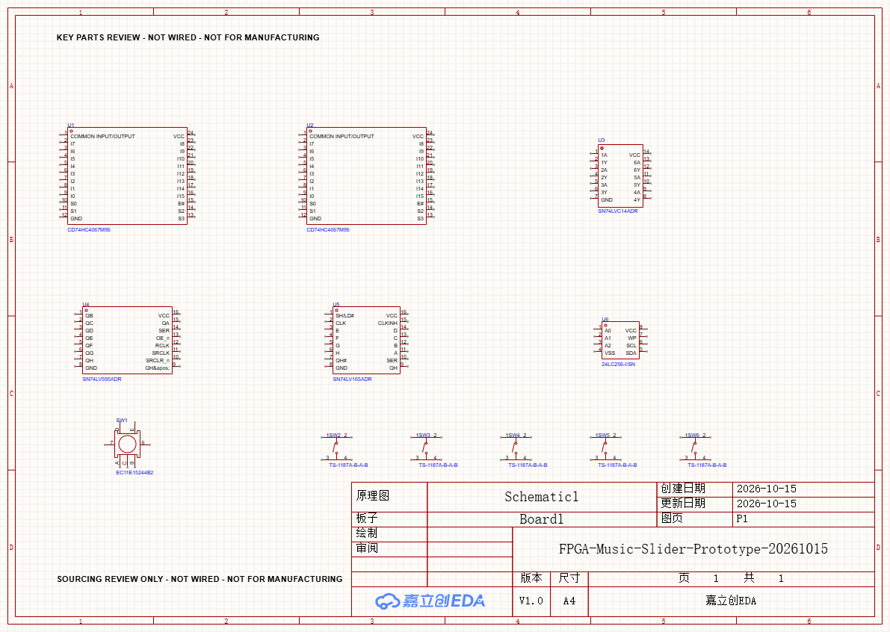

# 嘉立创硬件选型审阅包 · 2026-10-15

状态：**部分实现**。精确型号/器件库身份及下面的元件读回范围**已验证**；原理图接线、ERC、PCB/DRC、传感器实测与完整人民币报价**待实现/待验证**。这是选型审阅包，不是可生产电路或采购订单。

用户已恢复硬件选型。保留两排逐音滑条/两个八度、独立八度选档条（不测力）、四预设、编辑、按压旋钮、设备断电保存，以及原音乐/表情/分层目标。500元为新增硬件与制造总预算，已有Nano20K、屏、喇叭排除；55号可视化待优化项继续挂账。

图中12个关键元件实际位于嘉立创工程内；**尚未接线**，没有传到PCB。图中矩形布局只供识别器件，不是面板结构或PCB布局。

## 1. 主要候选

| 用途 | 型号 / C号 | 4滑条小样数量 | 完整8路前端例数量 |
|---|---|---:|---:|
| 电极复用 | TI CD74HC4067M96 / C496123 | 2 | 8 |
| 施密特整形 | TI SN74LVC14ADR / C133541 | 1 | 2 |
| 地址、禁用与公共充放电驱动锁存 | TI SN74LV595ADR / C205940 | 1 | 1 |
| 四预设、编辑、旋钮A/B/按压输入 | TI SN74LV165ADR / C273656 | 1 | 1 |
| 断电保存 | Microchip 24LC256-I/SN / C411625 | 1 | 1 |
| 按压旋钮 | Alps Alpine EC11E15244B2 / C470754 | 1 | 1 |
| 四预设＋编辑按键 | TS-1187A-B-A-B / C318884 | 5 | 5 |

完整数量是工程规模例，不表示新滑条、所有乐器和资源已经通过；也不要求在小样用量之外再重复买一份完整用量。可复用器件、最小购买量/包装倍数须在实际报价中扣算。

- 旋钮候选为30定位/15脉冲、20mm扁轴、1.5mm按压行程；厂家列为Standard。原EC11E15244G1国内页本轮为0库存；EC11K1524406虽有货但厂家标NRND，不作新设计优先。Bourns另一候选有货，但其手册不推荐手工焊接；不将它直接替换到手焊原型。旋钮帽、支撑/开孔与库中通用封装仍需机械核对。
- EC11E厂家列出A/B最小工作电流1mA；原通用10k上拉在3.3V下仅约0.33mA。A/B改列2.2k候选（约1.5mA），按压列4.7k候选（约0.7mA），五个普通按键仍10k。计算不是3.3V低负载寿命保证，需实测/厂家规格确认；防抖和转速也尚未验收。
- 47k测量电阻仍是实验初值，不是已验证的电容滑条方案。MUX公共端寄生、走线和覆盖层必须实测。右手、八度档数及25/26端点未因选料被重新裁定。
- 查到原47k/10k阻值料号国内页显示无货，换列同规格Yageo候选；220Ω原库手册链接带其他C号，也改列独立匹配的Yageo候选。47pF比较负载改列Murata候选，国内库存尚未核实，只在小样使用，不影响完整两参考负载方案。

## 2. 文件与平台工作流

- `catalog-checked.json`：18种型号、C号、真实library/device/symbol/footprint UUID及候选状态。
- `prototype-bom-import.csv`：4滑条小样的候选采购用量；`full-example-bom-import.csv`：完整规模例。**都还缺连接器、完整保护与结构等，不是最终BOM**，可导入BOM云表准备匹配报价，本轮未上传云表/购物车。
- `keyparts-native-verified.csv`：嘉立创实际导出BOM，经独立脚本核对7类、共12件关键料，并转换UTF-8；原始UTF-16制表符文件另存`keyparts-native-original-utf16.tsv`。
- `pins-readback.csv`：129个实际引脚号/名称/坐标，坐标来自API，不按符号外形猜引脚。
- `supply-review.csv`：国内公开页库存字段、售卖倍数字段与未报价状态。不要把库存当锁货，或把最小购买字段1误作所有阻容都能买1颗；本轮部分阻容`theRatio=100`，需核真实包装规则。
- `channel-map-example-25.json`、`...-26.json`：完整感测地址容量例；不是最终物理布线或用户音位定案。
- `budget-ceilings.json`：500元上限分配，**不是实际价格**。
- `eda-review-project.zip`：本轮保存后的本地嘉立创工程副本，不含制造Gerber；`review-audit.json`：来源、校核结果和SHA-256。

本机工程：

`C:/Users/Sakuya/Documents/LCEDA-Pro/projects/FPGA-Music-Slider-Prototype-20261015/FPGA-Music-Slider-Prototype-20261015.eprj3`

平台连接为4.1.71、connected/versionMatch/resultChannel均true。按C号批量查询仍返回空；**改用完整MPN搜索，再同时核对manufacturerId和supplierId**，保留真实库UUID。客户端项目刚打开时需等加载完成再读项目/图页，早读返回undefined不能直接当失败。项目UUID在路径打开方式下与旧记录不同，使用当前返回值和已核路径，不复用旧UUID硬切项目。

原生BOM使用示例过滤器时只返回空表头，本轮无过滤导出成功，再独立核对全部C号、型号和数量。API返回ok/文件存在均不足以宣称导出正确。第一次画布截图裁切，最终采用整图PNG导出并人工查看，12件关键料可见且与标题栏分开。

本轮仅操作助手创建的隐藏会话；收尾已关闭该会话，用户原窗口保留。浏览器工具仍存在内核运行错误；因此没有登录商城、填造购物车或声称已有最终成交报价。

脚本与原始证据：`../../../notes/hardware-selection-resume-20261015/`。执行`build_catalog.py`重新生成清单；`finalize_review.py`验证原生BOM/引脚/通道容量、保存项目副本；它们依赖当前留存的真实返回，不会替用户下单。

## 3. 通道与接口容量修正

8路×16地址=128总节点。若每路保留3个校准电容，剩104感测节点，只够25音位示例104，26音位示例107会超出容量。

完整规模例改为每路2个校准地址（10/100pF），剩112感测节点：

| 音位示例 | 音高节点 | 八度节点例 | 右手节点例 | 感测合计 | 校准 | 总占用 / 128 |
|---|---:|---:|---:|---:|---:|---:|
| 25 | 75 | 5 | 24 | 104 | 16 | 120 |
| 26 | 78 | 5 | 24 | 107 | 16 | 123 |

八度5段、右手24节点均为容量示例，不重新冻结用户交互或几何。给出的映射允许同条3电极跨测量路，必须做跨路归一化和帧内时序检查；不能用112的算术容量签收位置性能。4滑条小样每路6电极，仍保留10/47/100pF三种实验负载。

18信号的共享串行外围接口例继续保留：共享SCK/MOSI2、595锁存1、165并载/读回2、8路计时8、LCD CS/DC/RST3、EEPROM2。未预留TE/MISO/独立背光调光，真实排针/供电未签收。显示SPI期间禁止误锁存595，触控和按钮调度不能等待整屏完成；这些控制尚未接合验证。

## 4. 500元规划及下一步

| 预算项目 | 上限分配（元） |
|---|---:|
| 感测/扩展IC | 85 |
| 阻容、保护、连接 | 50 |
| 旋钮、按键、帽 | 30 |
| 原型PCB | 50 |
| 完整PCB预留 | 95 |
| 装配焊接 | 60 |
| 覆盖层固定 | 40 |
| 运费 | 30 |
| 预备 | 60 |
| 合计 | **500** |

实际单价、MOQ/售卖倍数、板面积/最低数量、装配与运费未完成报价；不用国际站USD冒充人民币，不依赖免费券。预算可行性仍待报价与原型证据，不能发布“500元已经足够”。

接下来按这些库引用完成小样原理图、保护/去耦/测试点和真正接线检查，再做PCB与实际计价。先验证相邻滑条位置、串扰、覆盖层、静按和释放，再扩完整规模。完整产品还要联合资源/真实引脚/PnR、触摸到声音≤10ms与实屏验证；本轮没有修改原音乐引擎、下载码流或提交生产采购。

来源：[厂家旋钮B2](https://tech.alpsalpine.com/e/products/detail/EC11E15244B2/)、[国内旋钮商品](https://item.szlcsc.com/476834.html)、[LVC14国内商品](https://item.szlcsc.com/144847.html)、[EEPROM国内商品](https://item.szlcsc.com/403162.html)、[TI 4067](https://www.ti.com/lit/ds/symlink/cd74hc4067.pdf)、[TI 595](https://www.ti.com/lit/ds/symlink/sn74lv595a.pdf)、[TI 165](https://www.ti.com/lit/ds/symlink/sn74lv165a.pdf)。
