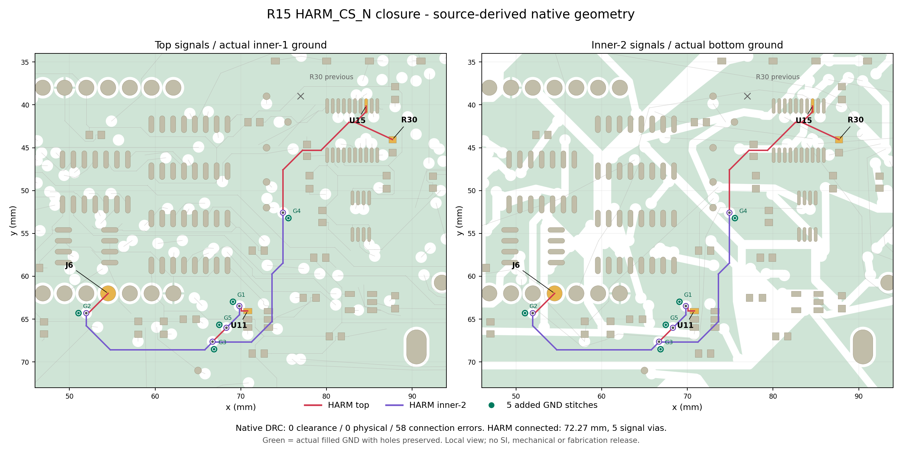

# R15：HARM 闭合与局部回流复核

当前继续工作的原生工程：`C:\Users\Sakuya\Documents\LCEDA-Pro\projects\FPGA-Music-Dualscreen-HarmClosure-20261021-r15`，专用 `native_project.py`，会话 `5f9103d1-1d21-447c-aca2-50e7aefa6a13`。ACTIVE-ROUTING-CANDIDATE.json 已晋升R15。采购数量基线 CURRENT-STATE.json 仍保留R3，不能用其旧PCB/CPL制造当前候选。

## 已验证结果

- 原生保存、四层地铜重建、关闭重开及完整DRC：**0间距 / 0物理 / 58未连通对象，剩11网**；此前R7为62对象/12网。230组件、1079焊盘、3288 API线+28原生微短线=3316段铜、530孔、4铜层。
- HARM_CS_N整网几何及原生连通，72.272362mm，5个新信号孔；R30移到实际焊盘中点87.69858/44.80052mm、270°，型号/值/焊盘/网络不变。R30.1仍接3V3_IO。所有原3V3_IO铜记录精确保留，未改供电拓扑。
- 新增5个GND孔，24mil盘/12mil钻孔，分别离信号换层点约0.9mm；每孔环形铜均实际接入内1与底层参考地，各层接触面积约0.204mm²。0.9mm为几何结果，1.5mm筛选目标不是标准或SI验收。
- 另外229个器件/焊盘、所有非HARM铜线、原520孔、规则、物理叠层、网络值、原理图及17个支持文件不变。原R7全部19文件哈希保持；音频铜及参考地投影未恶化。
- 原生清理合并HARM一段0.001mil短片，几何差异明确限于25.4nm；非HARM铜记录逐项精确相等。见actual-layout-review.json，不把API遗漏的28条微短线忽略。

图为真实保存源的几何重绘，绿色保留地铜孔洞；不是编辑器截图或实测。图已视觉检查，局部范围不代表整板制造图。

## 仍未关闭

HARM顶层对内1参考地投影98.22%，内2对底层89.19%（排除换层孔1mm及通孔焊盘0.5mm区域）；剩余投影空缺约0.417/3.903mm，最长单处0.417/1.487mm。已定位到remaining-reference-gaps.json。未建模实际边沿、线缆负载及回流波形，**不认定SI通过**。原I²S参考覆盖不足问题仍在。

剩余网络：BUS_SCK, BUS_MOSI, ADDR1, ADDR2, ADDR3, MUX_DISABLE, ADDR0, PRESET3, INV2, DISP_SCK, DISP_MOSI。H05仍in_progress；机械配准、感应寄生、电源负载/热、准确屏幕出货配置/到手价、完整产品固件集成及最终工厂叠层仍需关闭。双屏和84电极能力保留，本轮未改产品RTL。

历史CPL的**C35、R30两行失效**。当前API读取/修改/DRC可用，但原生外部文件导出权限拒绝尚未获恢复证据；不再盲试或改权限绕过。最终同版Gerber/钻孔/BOM/CPL和平台匹配仍未齐，不能下单制造。采购Excel数量/料号未因本轮布线变化而更改。

## 保存、失败边界与继续方法

PCB SHA256 `5029ca7091053a207a08908edfbe4b2716058640fa654b720c08c2bc0333cacb`；原生ZIP `D:\FPGA-Project\codex-deliverables\dual-screen-review-20261020-v2\native-4L-230-0clear-58open-harm-r15-20261021-CANDIDATE.zip`，SHA256 `5ba5a61f61c66213f5b5de9cce23e9657d5da487e4572cd8a3f5d79646509a7e`。19文件完整SHA清单在native-candidate-checkpoint.json，ZIP逐文件哈希与CRC已验证。改前R7快照 `D:\FPGA-Project\snapshots\before-harm-r15-20261021-204423\native-source-before-r15.zip`；补地前R15在pre-ground-native-source.zip。所有旧版本保留。

R12/R13的长绕行比较未导入。R14只得到三个端点的部分路径；R15移动同一上拉后完整闭合。最初重复大几何联合的慢搜索已停止，使用等价预筛算法，详见search-performance-change.json；不是物理无解。原生清理冗余电源短片，最终原电源铜完全未变。

接续只用当前R15捕获/哈希和专用wrapper，先联合评估ADDR/PRESET/显示网络；如用Freerouting，必须从R15重新生成DSN，不重放R7输入或覆盖已闭合HARM。保留保护区，比较总长度/孔数/回流与原生DRC，避免只降低未连通数。未发生付款/下单/联系供方/下载固件/账户变更。

automation-2在当前用户目录仍ACTIVE每小时；防休眠helper已结束，不保证休眠唤醒。goal查询仍返回paused，但本轮最新人类“继续工作”授权已恢复工作意图；无主动resume接口，不更改账户或伪造状态，不标complete。目标未完成。
