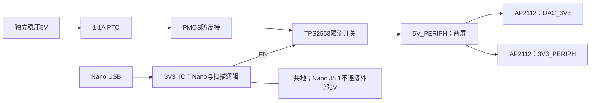

# 双屏供电及模块接口 v2 · 2026-10-20

状态：电路已实现、原生网表静态核对通过；上电、负载、温升和漏电待实测。原理图检查通过不代表这些实测已完成。

## 电源树

1. 入口采用 JST B2B-XH-A(LF)(SN) / C158012：本项目定义 1=+5V、2=GND，配套线束必须按此制作。接插件方向不能从屏幕或其他设备线色推断。
2. F1 为 Bourns MF-MSMF110/16-2 / C210834，23℃保持电流 1.1A。其电阻及环境温度降额会造成压降，不能当作任意温度下的精确 1.1A 限流器。
3. Q1 为 DIODES DMP2035U-7 / C110499，D 接输入、S 接输出、G 经 100k 下拉。这一级处理反接，不承担过压稳压，也不保证任何方向的电流都被阻断。
4. U17 为 TPS2553DBVR / C55266，使用高有效、恒流恢复版。23.7k / 1% 设定电阻 C22912，按 TI 式(1)(2)并带入电阻 ±1%，静态限流边界约 **1.002–1.184A**。这不是可供整机长期使用的额定负载；短路/过温和启动仍需测试。
5. 外设只有在 Nano 3.3V 存在时使能。开关没有被假定为快速放电器，10k 泄放电阻的下降速度取决于模块总电容。
6. DAC 与数字外设分别用 AP2112 供电。两路 3.3V 和 Nano 的 3.3V 输出不能并联。输入只允许稳压 5V；电路未加入可承受 9/12V 的过压保护。

PTC 的 0.21Ω 上界在 0.8A 时产生 0.168V 压降，开关、PMOS、线材还会增加压降。必须在屏幕端测量最低输入时的电压及启动波形，不能因历史记录写过“5V3A”就跳过。用户当前电源输出未知。

三个 3.3V 电源域各加 1kΩ 泄放电阻 R71/R72/R73（复用 C22548），分别属于外设、DAC、Nano；每域约 3.3mA、10.9mW。按总注入 200µA 与 1% 电阻估算上限 0.202V，此为条件计算，仍须实测实际漏电、掉电时间和启动顺序。三个 3.3V 域保持隔离。

## 信号隔离与上电顺序

- U15 SN74LVC244A / C7668 由 3V3_PERIPH 供电，缓冲 SCK、MOSI、两路片选、DC、屏幕复位、触摸复位及恒高背光使能。Ioff 支持外设断电时的输入/输出隔离，不增加 FPGA 引脚。
- U14 TCA9517 / C544515 的 A 侧属 Nano、B 侧属外设，EN 接 B 侧 3.3V。B 侧 VOL 有偏移：必须按实际触摸控制器与 PCM5122 的 VIL、模块并联上拉与电容复核；B 侧不与另一 B 侧级联。
- U16 SN74LVC1G17 / C7836 将模块 INT 送入 Nano，电源接 Nano 3.3V，输入允许模块先有电。软件在完成触摸初始化前忽略 INT。
- 原有 Nexperia 回读选择器 U11 带 Ioff；RA8875 MISO 仍须在未片选时高阻。不能因为有回读选择器就省略模块验证。
- PCM5122 数据手册声明音频输入为 fail-safe LVCMOS；I²C 则改走外设侧隔离总线。启动时仍需静音、配置 PLL、读回和错误处理。
- FPGA 配置前，CS 上拉，SCK/MOSI/DC 下拉；595 的复位位上电未知，软件必须先锁存完整初值。此隔离电路不能代替共享总线仲裁。

四种状态需台架确认：两边均断电、仅 Nano 上电、仅外部 5V 上电、两边均上电；另外测试两种接通顺序和带电断开。测量各 3.3V/5V 电压、反灌电流、复位、片选、FAULT 和屏幕冷启动。当前没有这些台架结果。

## 屏幕连接候选

小屏依据 LCDWIKI MSP2401/MSP2402 文件：5V 供电时板上稳压旁路 J1 必须 **断开**；外部 BL/LED 输入必须接高才能亮。v2 已补入 J11.8 → 模块 pin8，走 3.3V 缓冲。MSP2402 额外电阻触摸脚不使用。

大屏 ER-TFTM070-5V4 的默认设置是并口，必须要求 **5V、四线 SPI、CTP、内部背光 PWM** 的确切可售配置；不能买到默认板后直接照自定义 12 针线束接入。V4 主手册直链返回 403，目前只有厂商公开索引与产品页佐证的候选针表，不能标记为取得并完整审过 V4 PDF。其连接器名称/RESET 标注有歧义，保持 H01 待定。

10 月 20 日再次核对：产品页更新说明为 FT5316 替代 FT5206，但 V4 接线示例仍出现旧芯片名称；按 `屏幕出货配置核对-20261020.md` 逐项确认本次出货版本，不能将两版资料混用。

`harness-contract.csv` 已加入厂家编号候选。它不是已批准的成品线束图；实际交付版、朝向、复位引脚、跳线和线规通过核对后才能释放。

## 主要依据

- [TI TPS2553](https://www.ti.com/lit/ds/symlink/tps2553.pdf)：DBV 引脚、EN、限流、反向保护、布局。
- [TI TCA9517](https://www.ti.com/lit/ds/symlink/tca9517.pdf)、[TI LVC244A](https://www.ti.com/lit/ds/symlink/sn74lvc244a.pdf)、[TI LVC1G17](https://www.ti.com/lit/ds/symlink/sn74lvc1g17.pdf)。
- [Bourns PTC](https://www.bourns.com/docs/Product-Datasheets/mfmsmf.pdf)、[DIODES DMP2035U](https://www.diodes.com/assets/Datasheets/DMP2035U.pdf)。
- [LCDWIKI 原理图](https://www.lcdwiki.com/res/MSP2402/MSP2402-2.4-SPI.pdf)、[MSP2401 机械图](https://www.lcdwiki.com/res/MSP2402/MSP2401_Size.pdf)。
- [大屏产品页](https://www.buydisplay.com/7-inch-lcd-module-capacitive-touch-screen-panel-i2c-spi-serial)、[V4 手册链接](https://www.buydisplay.com/download/manual/ER-TFTM070-5V4_Datasheet.pdf)。

未选 TPS22918：TI 官方说明 EN 先于 VIN 为高时软启动不生效，不能用于证明本设计两种供电顺序都限制涌流；保留其资料只作选型审计，不进入本轮 BOM。
