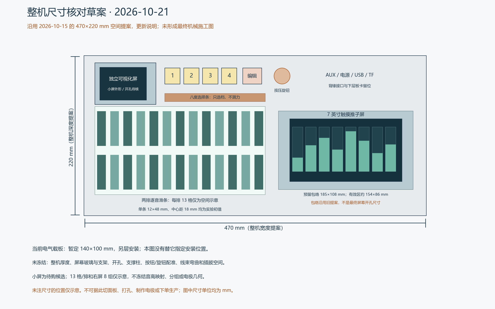

# 尺寸图、音位含义与未解决事项 · 2026-10-21

本轮只核查和整理图文，没有修改原理图、PCB、产品 RTL 或映射选择。

## 尺寸图的实际版本

现存有尺寸的整机面板图源于 2026-10-15 的 62 号布局提案：整机俯视包络 470×220mm，右手 7 英寸、左手两排逐音滑条、上方独立八度条、小屏与预设/编辑/旋钮。尚未找到此后完成审签的整机机械图。本轮依据该提案重绘尺寸核对图，修正小屏为待购候选等说明，**没有把旧包络升级成最终尺寸**。

| 尺寸 | 实际含义与状态 |
|---|---|
| 整机 470×220mm | 面板宽×深的空间提案，不含已确认厚度，不是切割图 |
| 载板 140×100mm | 当前 quality-r1 暂定 PCB 板框；不是整机尺寸，也不是电极操作面板 |
| 右屏包络 185×108mm | 旧提案给候选屏预留的空间，不是当前 ER-TFTM070-5V4 出货版的精确尺寸或开孔 |
| 右屏有效区约 154×86mm | 7 英寸候选布局示意；最终按所购模块图纸核定 |
| 单条 12×48mm，中心距 18mm | 电极触控区实验初值，尚未通过实际覆盖层、线缆及手感标定 |
| 每排 13 格 / 右屏 8 组 | 容量和界面示意，不冻结最终数量、音高或推子分组 |

整机高度、屏幕玻璃/PCB/背光/排线完整外形、开孔、安装孔、支撑柱、外壳、USB/TF/电源/AUX 插拔和线束弯曲空间均未完成机械审签。PCB 上按钮/旋钮的位置尚未与此面板配准；不能据图认为可直接穿过面板。Nano 当前线束方案也未完成直接叠插资格确认。

当前板图见 `hardware/review-manufacturing-20261019/visual-quality-r1-20261021/current-layers.png`。它是实际保存铜线的审查图，不能代替制造导出或精确的机械装配图。

## “最终音位数量和起止音映射”是什么意思

- 音位数量：左手实体滑条位置的个数，一条滑条按三个电极实现。
- 起止音：每排从哪个基准音开始，到哪个基准音结束；“每排一完整八度”本身没有指定实际音区。
- 映射：每个实体位置对应哪个基准音，以及八度选择档如何改变这些音高；条内滑动范围/曲线另需收口。

49 号设计总纲第 123 行明确：旧表暂按 25 音位（24 个半音间隔加高端点）计算，同时保留 26 音位增量，两排是否都独立包含完整端点尚未明确。所以 25/26 主要是**两排是否重复保留交界端点**的区别，不一定是多一个不同音高。

只作解释的例子（未替用户选择实际音区）：若第一排 C4 至 C5、第二排 C5 至 C6，两排各含 13 个半音位置，C5 有两个实体位置，因此共 26 个位置、25 种不同基准音高。如果交界 C5 只保留一个实体位置，则合计 25 个。68/69 号的 26 端点测试也明确不是最终音乐映射的冻结决定。

当前载板 84 路：25×3+5=80，剩 4 路；26×3+5=83，剩 1 路。两份 OPTION CSV 只分配物理节点，没有给每个音位确定 MIDI 基准音，也没有选中其中一份。不要把示例 C4/C5/C6 写入最终标识或程序默认值。

## 当前未解决问题

| 类别 | 尚未解决 | 关闭所需证据 |
|---|---|---|
| PCB 电气连接与布线 | 最新完整 DRC 为 0 间距/0 物理错误、78 项未连通，涉及 17 网；中部出线、I²S 9/8/10 个过孔和回流仍待整理 | 同版完整连接、合理回流与电源通道，保存重开后 DRC、ERC/网表及制造输出复查 |
| 整机机械与装配 | 470×220 与 140×100 尚未机械接合；屏/按钮/旋钮/支撑/外壳/插拔空间未定；Nano 实际版号、排针配合和编码器孔槽待核 | 对应实物的尺寸/孔位/装配图、干涉与安装验证 |
| 大屏配置 | ER-TFTM070-5V4 的确切 5V/四线 SPI/CTP/背光出货配置；FT5316 与旧样例 FT5206 差异；实际触点、IO 及针脚未闭环 | 出货 SKU 对应资料、接口图和实际模块通信记录 |
| 小屏配置 | MSP2401 修订、供电稳压旁路、背光、视角、实际接口和初始化未实物确认 | 对应模块与供电/背光/显示实测 |
| 供电链 | 实际电源、两屏峰值与稳态负载未知；F1/R67、压降/温升/启动/关断/反灌尚未验证；SPICE 只是局部假设模型 | 实际屏幕负载替换假设，限流电源/示波器/电子负载的边界与热测试 |
| 传感前端 | 三电极触摸量、连续位置、邻指串扰、覆盖层/线缆/漏电/噪声/漂移、47k 量程、扫描速度和标定未实测 | 实际材料小样、少量滑条到完整规模的测量；当前旧 16 路数字仿真不能替代 |
| 接口与固件一致性 | 最新扫描节点、引脚与产品顶层未全面闭环；共享 SPI 仲裁、595/165 操作、屏忙读回/超时、触摸、PCM5122/I²C 启动仍需接入及验证；线束厂家针脚未签核 | 对应最终硬件的完整接口表、真实驱动与错误恢复测试、逐线配对 |
| FPGA 联合实现 | 86 号结构探针联合路由失败，且不是实际产品协议；没有通过完整时序签核的最终整机码流 | 保留双屏与既定功能的产品顶层、完整约束、联合 PnR/STA 及绑定源码的码流 |
| 整机功能闭环 | 已有音乐/位置/存储独立成果，但完整 TF 文件、最终录放混音、断电保存、四层与实体 UI 尚未形成最终整机闭环；各项按原记录保留已实现与未实现边界 | 保存/重启/载入/伴奏与现场演奏并发、配置/释放/错误恢复的完整实体测试 |
| 交互规则 | 25/26 端点及 MIDI 基准、八度在奏切换、右手分组/强调曲线/对分层与伴奏的作用范围仍有原记录未决项 | 回查用户已确认记录后形成唯一规则；确无决定的项再由用户选择，不擅改功能 |
| 制造、采购与线束 | 最终 Gerber/钻孔/BOM/CPL/DFM、SMT 匹配与替料、通孔/按钮焊接分工未完成；线束/壳体/端子与装配清单未闭合；没有整机人民币含运报价 | 同一最终源的制造输出、平台匹配/实际完整报价和线束检验；旧 652.76 元模型不算现版报价 |
| 最终实机验收 | 真实双屏、电极、音频、存储并发下的最坏触摸到声音延迟、稳定性、温升、上电/掉电和操作体验未验 | 同版实物/固件在完整负载下测最坏延迟、持续运行与故障恢复并保存记录 |

本表根据 `release-open-items.csv` 的 H01–H10、LATEST、SPICE 报告和主项目 49/62/68/69/86 号记录整理。不是所有功能都未实现，而是独立成果不能替代最终整机签收。本轮没有重新执行 DRC/PnR/实测，DRC 数字引用最后一次有源身份绑定的原生结果。

## 可追溯来源

- 主项目 `docs/02-技术方案/62-七英寸右手触屏选型与整机布局评估-2026-10-15.md` 第 4 节和原 `hardware/seven-inch-selection-20261015/layout.png`。
- 主项目 `docs/02-技术方案/49-最终收敛设计总纲-2026-10-15.md` 第 123 行，以及 68/69 号测试边界。
- 当前 `hardware/review-manufacturing-20261019/LATEST.md`、`release-open-items.csv`、`route-checkpoint-0clear-78open-quality-r1-20261021.json`。
- 本轮图形源和哈希：`dimensions-review-20261021/draw_dimensions.py`、`provenance.json`。PCB SHA256 仍为 `be576cabac058fc0754fbc87a07565e69531e59c7d249a6f6d267c5f93c5fc3e`，制造放行仍为 false。
