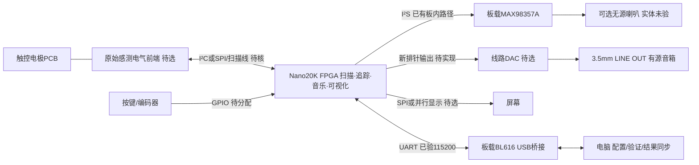

# 整机IO与PCB分工

2026-10-10。唯一应用计算平台Tang Nano20K FPGA。以下为现有连接核对与推荐结构，不代表已冻结器件/引脚、PCB已完成或用户批准采购。

## 整机连接

显示不经UART回传电脑再计算；坐标/触点身份算法不能在感测前端外包。原始感测前端不含应用计算MCU；逐器件核实转换和算法边界。前端未定，不能保证只用两根I²C信号线就能完成所有电极扫描，可能另有激励、选择、IRQ/复位等引脚。

当前04是完整32组UART模拟输入诊断版，未接真实触控新前端；I²C模块已有独立数字判据，当前音频顶层没有实例化它。旧16路RC pads逻辑保留，不能作为新连续位置/多指实体输入已完成的证据。实体显示接口尚未实现。已有内部音频样本和I²S数字链证据，不等于DAC模拟输出已实测。

## PCB和底板分别是什么

I²C是SDA/SCL通信协议，不要求必须新制PCB；短线模块可以在实验中连接。我们需要电极PCB主要为固定几何、覆盖层、寄生和布线，保证可重复的触控测量；并非I²C有“必须PCB”的规定。

推荐机械/电气分工：

| 部件 | 承担内容 | 当前边界 |
|---|---|---|
| Nano20K开发板 | FPGA、既有时钟/电源与下载桥 | 继续用已在手板，不重新做FPGA核心板 |
| 触控电极PCB/面板 | 独立滑动键或互电容几何；按实验布局原始感测前端、电极连接器 | 形态/通道/前端未选定，先小规模实验 |
| 自制电气底板/载板 | 插接Nano、供电分配、去耦、上拉、连接器、音频/显示引出、按键、测试点与安装孔 | 推荐，尚未完成原理图/布局/引脚预算；不含新增计算平台 |
| 绝缘安装底板 | 用铜柱/螺钉固定各板和屏幕，机械保护 | 不一定是PCB；原采购P-06主要指这个 |

上述是功能分区，不强制固定PCB片数。推荐Nano＋载板＋可替换电极板，音频模块/屏幕可先以模块安装；后续能合并部分PCB。长而松散的电极线会改变寄生/耦合，模拟感测布局应按所选器件参考设计与实际噪声验证；不能照搬数字连接器布线。

“底板”不指必须购买Primer的Dock/Lite，我们固定Nano20K。新的载板用于整机集成、固定与连线，不增加运算资源。

## 引脚预算与设计门禁

| 通路 | 信号预算 | 需确认 |
|---|---|---|
| 原始触控前端 | I²C为2信号脚，SPI常为3/4脚；额外激励/选择/IRQ/复位另计 | 转换速度、全通道数据量、算法边界、上拉/电平和真实≤10ms |
| 外接线路DAC | BCK、WS、DIN，可能另有MCLK/使能 | 排针可达、时钟格式/位宽、供电和模拟输出 |
| 屏幕 | SPI数据/时钟/选择＋DC/复位/背光等；并行用更多数据和控制脚 | 类型、吞吐、引脚、bank与FPGA资源 |
| 实体操作 | 按键/编码器/指示灯按最终数量计 | 防抖、上电默认、功能与N-09语义，不擅自冻结 |
| 供电/调试 | 电源与GND、测试点，不计为FPGA信号GPIO | 一致电平、供电容量、回流与音频/触控噪声 |

当前CST中的UART70/69、板载DAC DIN54/WS55/BCK56、PA_EN51是FPGA封装管脚编号，不是排针第几个孔。音频信号为板内连接；不能假设可由现有排针直接接外部DAC。必须核对Nano原理图和实际焊接后建立“信号→封装管脚→排针丝印/位置→底板连接器”的新表，再分配端口及CST。

触控及屏幕占脚较大，不能只数芯片总IO；要核对板上已连接、排针实际可达、bank电平、时钟脚和保留功能。先冻结原始感测接口、显示与DAC时钟，再做全机引脚预算和供电树；评审完成后才冻结载板原理图。新增IO/约束/RTL需新源身份、关联数字判据、联合PnR与真实板验，旧04证据保持原边界。

依据：[NXP I²C规范](https://cache.nxp.com/docs/en/user-guide/UM10204.pdf)说明两线通信；[TI电容感测布局指南](https://www.ti.com/lit/an/snoa926a/snoa926a.pdf)说明PCB/寄生布局影响，引用仅为电气原则，不引入其MCU方案。项目入口为CURRENT/design/integration，音频候选见[audio-output-plan](audio-output-plan-20261010.md)。
