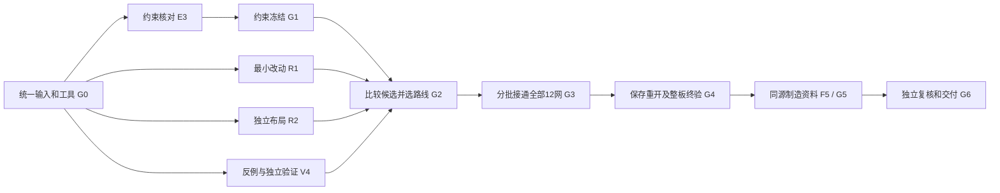

# PCB多Agent执行包：由用户分配，按产物验收

本包把951施工板推进到**完整可编辑PCB工程和可提交工厂审查的制造资料包**。本轮只规划与准备任务，六个角色均尚未分配、尚未执行。任务完成不等于已下单、已制造或实物性能通过。

任务卡、共同合同和最终验收表应一起交给接手Agent；用户决定由哪些聊天承担角色。建议六个角色、分批最多四个活跃执行者。M0全程负责收口；R1/R2采用不同方法；V4负责独立反证和终验；E3提前解决电气/机械约束；F5负责把通过的设计变成完整文件交付。

## 固定起点

- 工程源提交：`7c344f34d7183d24bd53e2f8ceaf85a7b8f6cb2b`；完整源快照提交：`592da06fd64d069614ba5cb1647dad168aa4ef02`。
- 任务包所在分支：`codex/pcb-sync-plan-20261025`，PR #5尚未合入main。先fetch、核对实际main，再取得包含本包的确切任务分支提交；不要用旧main的e098替代本任务的951。
- 原生PCB SHA256：`951ce88a1a2fcc2d758f9a53222a400cbddd3bc5b689cc2a37c98b8303d9ca4d`。
- 输入：`hardware/checkpoints/pcb-951ce88a-20261025/`，19文件原生工程、14张原理图、离线候选、采购上下文、完整恢复ZIP分卷。
- 基线实际边界：原生227件、649孔、42项未连通、12个开放网；离线MUX四岛尚不可导入。旧音乐黄金差异和主机/FPGA实体兼容缺口保留。
- 本轮输入校验通过；全域治理仍过期并有活跃源漂移。M0必须形成**针对所选硬件和本任务范围的新审阅**，不得把旧日期改新或为无关FPGA/主机续期。固定源可做限定分析，进入正式施工前需完成G0/G1。
- 推送目的地：精确核对URL的`internal`，用户已授权当前Public可见性。各任务使用自己的分支，正式main合并和制造放行保留用户决定。

## 六个角色

|角色|职责与首项产物|后续必须交回的结果|任务卡|
|---|---|---|---|
|M0 总集成负责人|建立B0、领取登记、约束/空间分配及基线报告|唯一正式PCB、全部12网闭合、版本链、合并与最终交付清单|[M0](tasks/M0.md)|
|R1 连通诊断与最小改动路线|搜索裁剪/真实障碍的对照证据|可复现完整候选，或有边界的否定结论；随后完成被分配的走线批次|[R1](tasks/R1.md)|
|R2 独立数字区布局路线|从实际951独立设计局部数字出口方案|另一份可比较候选；随后完成被分配批次或接替卡住的路线|[R2](tasks/R2.md)|
|E3 电气、接口与可装配性|带来源和性质分类的约束表、待决清单|板卡接口/供电/复位/线束/机械/装配合同及终版审核|[E3](tasks/E3.md)|
|V4 独立验证与反例|重现基线问题，验证检查器能发现故障|逐候选独立判定、原生终验、制造输出复核|[V4](tasks/V4.md)|
|F5 制造交付|提前定义生产资料格式和缺件表|同一冻结源导出的完整制造审查包及清洁目录恢复证明|[F5](tasks/F5.md)|

M0是正式板的唯一写入者。R1/R2各改自己的候选副本；E3/V4/F5不修改正式板。原06df、D盘生产目录和旧CAD工程只作来源，既有暂停自动化不恢复。没有新CAD工程唯一ID和当前会话核验，不操作旧会话。

## 启动顺序

1. **先分配M0和V4启动段**：登记owner、工作树、输出路径；验证恢复、工具/规则及原生基线，形成G0。不能把38个文件哈希通过当成DRC通过。
2. **第一波四路并行：R1、R2、E3、V4**。M0保留集成职责，按检查点汇总，不再同时跑第五个重型求解。E3先交最低可施工约束，V4先交可运行的检查入口；两位路线作者在副本做不同方法的实验。G1未确认项必须显式标识，相关施工不得签收。
3. **G2选方案后：M0、获选路线作者、E3、V4**。未获选作者改任剩余批次或反证角色；不得因“已经花了很多时间”继续占用同一瓶颈。
4. **最后一波：M0、V4、F5，E3按需复核**。F5从Bfinal导出资料，V4独立打开生产输出，M0确认最终包可恢复且所有硬门通过。

R1/R2无需彼此等待才开始，但G2必须由M0依据E3约束和V4结果选择。最多接收一个相互重叠的几何版本，不能把两个整板文件直接Git合并。详见[共同合同](CONTRACT.md)。

## 防止长时间走偏

这些是检查点和研究预算，不是承诺布线完成的时长。每个角色**前60分钟**交首个可检查产物；工具未就绪也交准确错误和最小复现。每45分钟记录一次有文件/哈希的进度；普通交互中的简短进度更新照常。

- 同一假设连续两次失败，或90分钟没有新可复核证据：暂停该方法，交V4反证/M0裁决。
- 路线研究累计2小时仍只有日志、窗口或“局部端口数”变化：必须交诊断包并调整任务；不能换名继续同一终态作业。
- 单次计算默认设置30分钟上限、内存/磁盘预算及停止后保存的最小证据。合理的长计算由M0基于测得规模调整预算，并写明理由，不能无限等待。
- R1、R2均无法形成完整候选：M0在一次检查点内提交**具体局部数字区重构方案**，包括改位图、影响范围、代价和验证方法；需要改变平台、板外接口、板框/层数或受保护模拟/传感区域时，才把具体选择集中交用户决定。
- 否定结果可以结束一个研究实验；**不能把线路未闭合的任务或整板终验标成完成**。恢复执行必须改变已证明有关的假设/方法/输入，并使用新run ID。

## 走线任务怎样继续分配

先由M0发布通道预留图，避免几个Agent抢同一出口：

|批次|覆盖网络|执行安排|结束条件|
|---|---|---|---|
|K1|MUX_DISABLE、ADDR0、ADDR1|获选路线作者主做；另一作者交叉检查|三网完整候选闭合，其他九网有可实施预留，独立审核后原生接通|
|K2|BUS_SCK、INPUT_LOAD_N、KEY_QH|M0按能力分配路线作者|信号/时序/参考合同满足，原生逐网闭合|
|K3|PRESET1、PRESET2、EDIT、ENC_A、ENC_B、ENC_PUSH|另一作者承接|六网闭合，既有PRESET0/3与其他网络不退化|

K2/K3只有在M0和V4确认空间、网络、供电/参考影响范围不冲突后才并行。输入B1相同并不意味着几何修改可以直接合并；每次接纳后生成B2/B3，其他候选重新针对新基线验证。

## 你如何派发

六张任务卡都可单独复制链接给Agent。建议第一条消息：

> 你负责PCB任务【角色ID】。请获取internal的codex/pcb-sync-plan-20261025分支中本任务包的最新提交，先读project/pcb-parallel-20261025/tasks/【角色ID】.md及其共同合同，按任务卡执行。先报告输入身份、独占路径和首个检查点目标；后续交回可复核文件、精确commit和未通过项。任务分配由我负责；各角色只向我或已获我授权的M0交接，不自行创建/唤醒其他聊天。

M0把你实际指定的聊天ID/owner填入`assignments.json`并提交；这里的空值表示**尚未分配**。若资源只有四个Agent，可让同一个人在不同阶段承担M0与F5；V4不能兼任其正在验收的候选作者。若只有三个Agent，保留M0、一个构建者、独立V4，E3先做，F5后做；不要删除独立验证角色。

## 最终交付的判定

所有完成状态均由[验收矩阵](ACCEPTANCE.md)和真实产物决定。需要可编辑工程、完整生产输出、原生验证、独立复核、逐文件SHA清单和新目录恢复证明；只有总结、图片或原生板仍有42项连接错误时，G6必须保持未通过。

已确认的PCB设计问题不得藏进“后续实测”。无法由软件证明的实物触控噪声、整机功能、上电电气性能等进入明确的样机测试计划，保持UNMEASURED；它们不能被Agent用模拟PASS冒充。最终包交用户批准制造，本包不自动下单。
